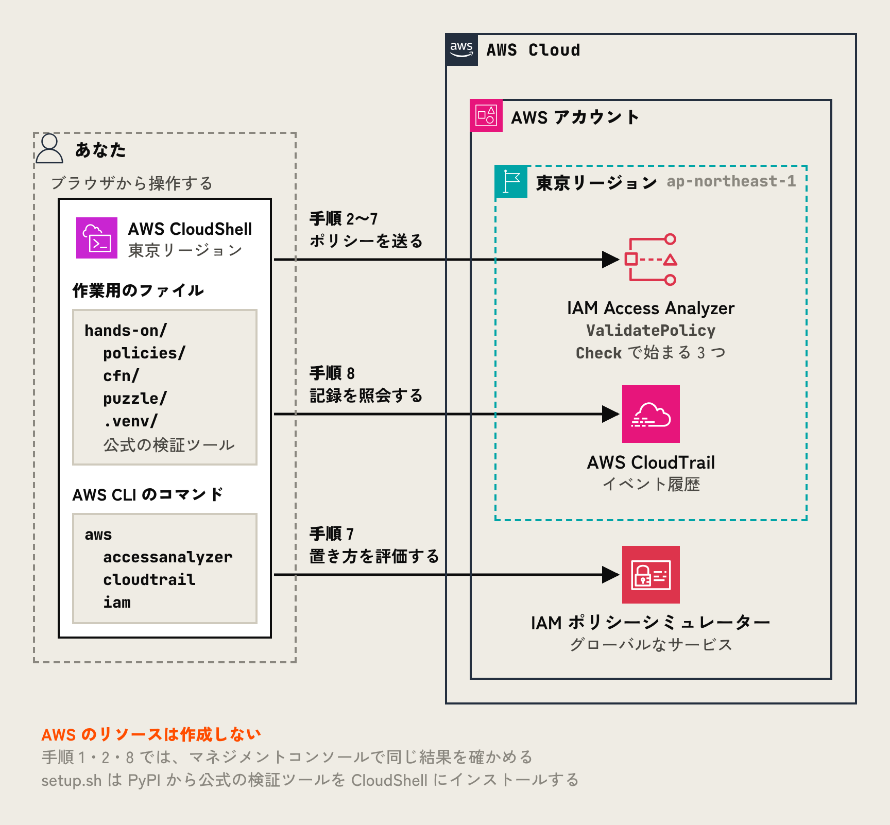
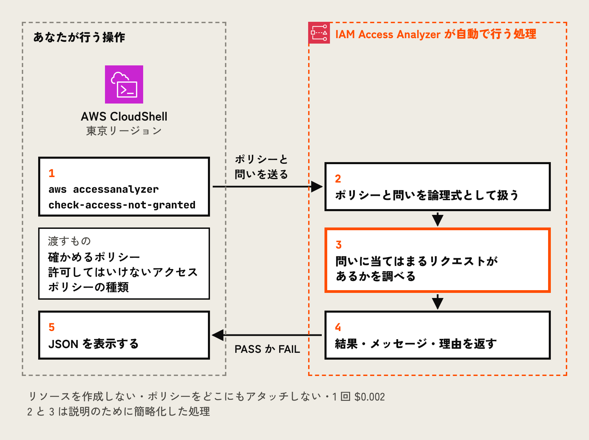
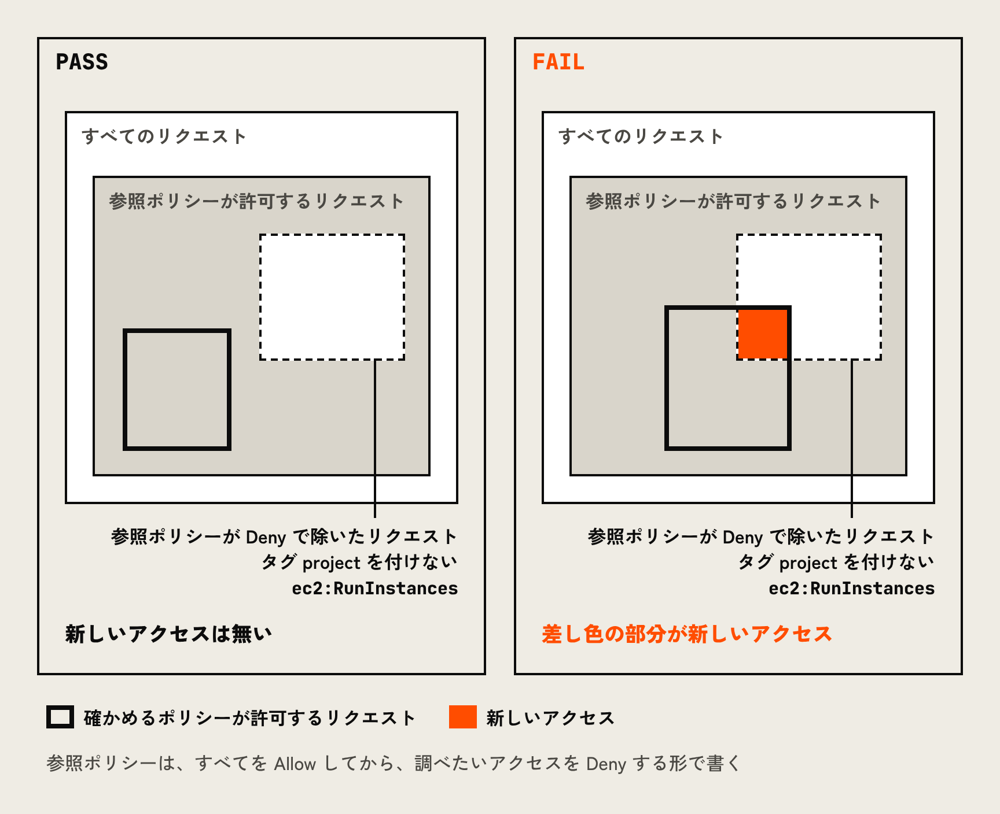
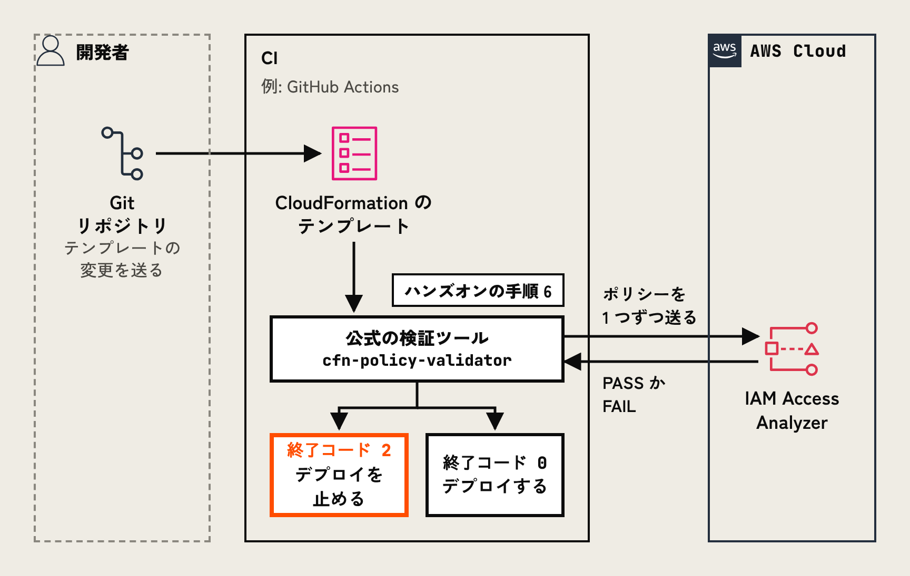
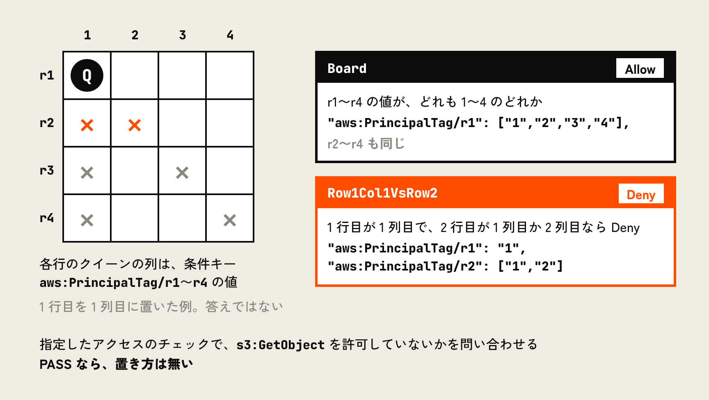
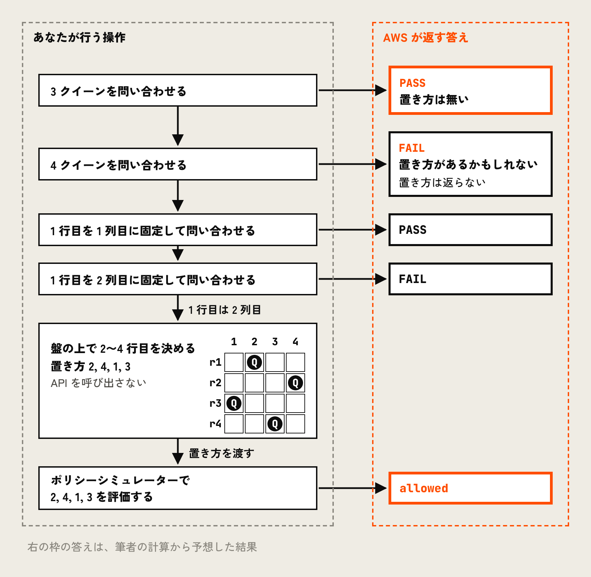

このリポジトリは AWS Deep Cuts の、IAM Access Analyzer のカスタムポリシーチェックに関するハンズオンコンテンツです。

<!-- TODO: 記事の公開後に、次の行のリンクを有効にする -->
<!-- IAM Access Analyzer の解説記事(Qiita)は[こちら]() -->

解説記事の原稿は [article/aws-iam-access-analyzer.md](./article/aws-iam-access-analyzer.md) にあります。

> **Note**: このハンズオンは、ブラウザから AWS CLI のコマンドを実行できる AWS CloudShell を使って、東京リージョン（`ap-northeast-1`）で実施します。
> - AWS CLI は 2.16.6 以降が必要です。2.16.6 より古い AWS CLI は、手順 5 の `check-no-public-access` コマンドと、手順 3-3 の `--access` での `resources` の指定に対応していません。[前提条件](#前提条件)の手順で確認してください。
> - このハンズオンでは、**AWS のリソースを 1 つも作成しません**。CloudShell のホームディレクトリに、公式の検証ツールをインストールした Python の仮想環境と、作業用のファイルを作成するだけです。

> 💰 **コストについて**
>
> このハンズオンでは、AWS のリソースを作成しません。料金の大部分は、IAM Access Analyzer のカスタムポリシーチェックの呼び出しで、東京リージョンで 1 回 $0.002 です。手順どおりに進めると約 30 回、やり直しを含めても 100 回以内と見積もり、上限は約 $0.20（約 32 円）です。既存の CloudTrail の証跡がある場合は、この上限とは別に、イベントの記録にわずかな料金がかかることがあります。アナライザーを作成しないため、放置しても費用は増えません。内訳は[費用の見積もり](#費用の見積もり)にあります。
>
> | 放置期間 | 概算コストの上限 |
> | --- | --- |
> | 1日 | 約 **$0.20**（約 32 円） |
> | 1週間 | 約 **$0.20**（約 32 円）。放置しても増えない |
>
> この金額は、カスタムポリシーチェックを最大 100 回呼び出した場合の上限です。1 ドル 160 円で換算しています。
>
> **ハンズオンの途中で、未使用アクセスや内部アクセスのアナライザーを作成しないでください。** これらは、分析する IAM ロールとユーザーの数や、リソースの数に応じて課金されます。課金の期間と数え方は、料金ページで確かめてください。

# AWS Deep Cutsとは
AWS Deep Cutsは、AWS の最新のサービスやニッチな機能、または高度にアカデミックな知識を要求するサービスなど、多くの人が知らない 『隠れた名曲 = **Deep Cuts**』 を深くまで掘り下げる技術シリーズです。

このようなサービスはWeb情報も少なく、初学者は気軽にキャッチアップできないのが実情です。

そこで AWS Deep Cuts シリーズでは、**前提知識も含めた分かりやすいサービス解説** と **手順通りに進めれば誰でも再現できるハンズオン** を提供します！

# ハンズオンのゴール

IAM ポリシーを書いたら、ポリシーをアタッチしたロールで実際に操作するか、IAM のポリシーシミュレーターで確かめる方は多いと思います。ポリシーシミュレーターは、ポリシーと条件の値を渡すと、1 つのリクエストが許可されるかを評価する IAM の機能です。リクエストは、AWS に送られる 1 回の操作の依頼です。どちらの方法でも、分かるのは、値を決めて試したリクエストの結果だけです。

このハンズオンでは、IAM Access Analyzer のカスタムポリシーチェックを使って、ポリシーを試さずに確かめます。カスタムポリシーチェックは 3 つの API です。どれも、ポリシーと問いを受け取ります。そして、問いに当てはまるリクエストをそのポリシーが許可しうるかを答えます。問いは、「このアクションを許可していないか」「変更前のポリシーより広いアクセスを許可していないか」「このリソースを公開していないか」のように、チェックごとに決まった形で渡す、確かめたい内容です。AWS CLI のコマンドを 1 つずつ実行しながら、次のことを自分の目で確かめます。

| 確かめること | 手順 |
| --- | --- |
| ポリシーの検証は書き方の誤りを指摘するが、何を許可するかには答えない | 2 |
| 指定したアクセスのチェックは、試さずに「許可していない」ことを答える | 3 |
| 新しいアクセスのチェックは、文字の差分ではなく、許可の範囲を比べる | 4 |
| パブリックアクセスのチェックは、リソースベースポリシーが公開しうるかを答える | 5 |
| 公式の検証ツールで、CI と同じ形にできる | 6 |
| ポリシーを論理式として考えたときの予想どおりにチェックが答えるかを、おまけのパズルで確かめる | 7 |
| チェックの呼び出しの記録を確かめ、請求の数量と比べる | 8 |

用語の意味と仕組みは、解説記事で説明しています。先に記事の「そもそも自動推論とは？」と「仕組み」を読んでおくと、各手順で何を確かめているのかが分かりやすくなります。

# ハンズオン手順

以降の手順は、ハンズオン用に用意した AWS アカウントで実施してください。

## 構築するアーキテクチャ



このハンズオンで作成するのは、CloudShell のホームディレクトリのファイルだけです。図の矢印は、あなたが CloudShell から呼び出す AWS の API を表します。

- あなたは CloudShell から AWS CLI のコマンドを実行し、東京リージョンの Access Analyzer の API を呼び出します。CLI のコマンドの名前は、API の名前に対応しています。たとえば `check-access-not-granted` コマンドは、`CheckAccessNotGranted` API を呼び出します。
- Access Analyzer は、受け取ったポリシーの文字列を調べて、結果を返します。リソースを作成せず、ポリシーをどこにもアタッチしません。
- 手順 6 では、公式の検証ツールが、CloudFormation のテンプレートのポリシーを 1 つずつ同じ API に渡します。
- 手順 7 では、IAM のポリシーシミュレーターも呼び出します。IAM はグローバルなサービスで、リージョンを問いません。
- 手順 8 では、AWS CloudTrail のイベント履歴を照会して、ここまでの呼び出しの記録を確かめます。

このハンズオンでは、あなたが CloudShell とマネジメントコンソールの両方を操作します。手順 1・2・8 では、CLI で確かめた結果を、マネジメントコンソールの画面でも確かめます。

## 前提条件

- AWS CloudShell を **東京リージョン** で開くこと
- AWS CLI が 2.16.6 以降であること。次のコマンドで確認します。

  ```bash
  aws --version
  aws accessanalyzer check-no-public-access --generate-cli-skeleton input > /dev/null 2>&1 && echo "OK: このまま進めます" || echo "NG: AWS CLI を更新してください"
  ```

  2 つ目のコマンドで `NG: AWS CLI を更新してください` と表示された場合は、AWS CLI が古いため、次の手順で更新してください。

  <details>
  <summary>AWS CLI の最新版をホームディレクトリにインストールする手順</summary>

  CloudShell の AWS CLI は、最新版より数バージョン古いことがあります。CloudShell のホームディレクトリは次回以降のセッションでも残るため、ここに最新版をインストールします。インストールした AWS CLI は、削除するまでホームディレクトリの容量の一部を使い続けます。

  ```bash
  curl -sS https://awscli.amazonaws.com/awscli-exe-linux-x86_64.zip -o /tmp/awscliv2.zip
  unzip -q -o /tmp/awscliv2.zip -d /tmp
  /tmp/aws/install --install-dir "$HOME/.local/aws-cli" --bin-dir "$HOME/.local/bin" --update
  export PATH="$HOME/.local/bin:$PATH"
  aws --version
  ```

  最初の確認のコマンドをもう一度実行し、`OK: このまま進めます` と表示されることを確認します。`export PATH=...` の行は、CloudShell のタブを新しく開いたとき、またはセッションが終了したときに実行してください。
  </details>

- Python が 3.8 以降であること。`python3 --version` で確認します。手順 6 で使う公式の検証ツールが、Python 3.8 以降を必要とします。
- CloudShell を開いた IAM ユーザーまたは IAM ロールに、Access Analyzer・IAM のポリシーシミュレーター・CloudTrail のイベント履歴の権限があること。`AdministratorAccess` 相当の権限で実施するのが簡単です。
- AWS Organizations は使いません。組織に属していないアカウントでも実施できます。

<details>
<summary>最小権限に近い IAM ポリシーの例</summary>

CloudShell を使う権限は、このポリシーとは別に必要です。たとえば AWS 管理ポリシーの `AWSCloudShellFullAccess` をアタッチします。

IAM ポリシーに書く Access Analyzer のアクションの名前は、`access-analyzer:` で始まります。CLI のコマンドの名前 `aws accessanalyzer` とは異なるため、注意してください。カスタムポリシーチェックの 3 つの操作は、リクエストにリソースの ARN を含まないため、`Resource` は `*` にしています。ARN（Amazon Resource Name）は、AWS のリソースを一意に指す名前です。

```json
{
  "Version": "2012-10-17",
  "Statement": [
    {
      "Sid": "AccessAnalyzerChecks",
      "Effect": "Allow",
      "Action": [
        "access-analyzer:ValidatePolicy",
        "access-analyzer:CheckAccessNotGranted",
        "access-analyzer:CheckNoNewAccess",
        "access-analyzer:CheckNoPublicAccess",
        "access-analyzer:ListAnalyzers"
      ],
      "Resource": "*"
    },
    {
      "Sid": "PolicySimulatorAndEventHistory",
      "Effect": "Allow",
      "Action": ["iam:SimulateCustomPolicy", "cloudtrail:LookupEvents", "sts:GetCallerIdentity"],
      "Resource": "*"
    }
  ]
}
```

手順どおりに進めた場合、アナライザーは作成されず、`cleanup.sh` もアナライザーを削除しません。そのため、このポリシーには `access-analyzer:DeleteAnalyzer` を含めていません。マネジメントコンソールで確かめる手順 1・2・8 には、IAM と CloudTrail のコンソールを読み取る権限が別に必要です。費用の見積もりの章で使う Cost Explorer の画面にも、別の権限が必要です。権限が足りない場合は、コンソールでの確認を省き、CLI の結果だけで進めてかまいません。
</details>

以降、各種コマンドは、東京リージョンで開いた[CloudShell](https://docs.aws.amazon.com/cloudshell/latest/userguide/welcome.html)で実行してください。

## １．事前準備

このハンズオンでは、AWS のリソースを作成しません。ただし、手順 6 で使う公式の検証ツールのインストールと、後片付けのための記録は、ハンズオンの本質ではないため、`setup.sh` で行います。

```bash
# このリポジトリをクローン
git clone https://github.com/AWS-Deep-Cuts/aws-iam-access-analyzer
cd aws-iam-access-analyzer/hands-on

# セットアップスクリプトの実行
bash ./setup.sh

# 以下の文言が表示されればセットアップ成功です
# ✅ セットアップが完了しました！

source ./handson.env
```

`setup.sh` は、AWS のリソースを作成せず、`hands-on` ディレクトリに次の 3 つを作成します。`setup.sh` が呼び出す AWS の API は、AWS STS（AWS Security Token Service）の `GetCallerIdentity` と、Access Analyzer の `ListAnalyzers` だけです。

| 作成するもの | 内容 |
| --- | --- |
| `handson.env` | `REGION`・`ACCOUNT_ID`・`START_TIME` の 3 つの変数。`START_TIME` は `setup.sh` を実行した時刻で、手順 8 で使う |
| `.analyzers-before.txt` | `setup.sh` を実行した時点で東京リージョンにあったアナライザーの名前の一覧。後片付けで、ハンズオンの途中にアナライザーが増えていないかを比べる |
| `.venv/` | Python の仮想環境。PyPI から、公式の検証ツール `cfn-policy-validator` の 0.0.37 をインストールする。手順 6 で使う |

`source ./handson.env` を実行すると、次の変数を以降のコマンドで使えます。

| 変数 | 中身 | 使う手順 |
| --- | --- | --- |
| `REGION` | リージョン `ap-northeast-1` | 1〜8 |
| `ACCOUNT_ID` | AWS アカウントの ID | 以降のコマンドでは使わない |
| `START_TIME` | `setup.sh` を実行した時刻。UTC の ISO 8601 の形 | 8 |

3 つの変数には `export` を付けています。手順 7 の任意の `solve.sh` のように、別のプロセスとして動くスクリプトにも `REGION` を渡すためです。

ハンズオンで使うポリシーとテンプレートは、リポジトリに入っています。

| ディレクトリ | 中身 | 使う手順 |
| --- | --- | --- |
| `policies/` | 確かめるポリシーと参照ポリシーの JSON | 2〜5 |
| `cfn/` | CloudFormation のテンプレート 2 つ。デプロイはしない | 6 |
| `puzzle/` | N クイーン問題をポリシーに変換する `make-queens.py`、変換したポリシー、任意の `solve.sh` | 7 |

> **Note**: CloudShell は、操作しない時間が続くとセッションが終了し、変数が消えます。その場合は、次の 2 行を実行してから続きの手順に進んでください。
>
> ```bash
> cd ~/aws-iam-access-analyzer/hands-on
> source ./handson.env
> ```
>
> 手順 6 の途中であれば、`source .venv/bin/activate` も実行します。前提条件で AWS CLI をホームディレクトリにインストールした場合は、`export PATH="$HOME/.local/bin:$PATH"` も実行します。

<details>
<summary>仮想環境を作成できない場合</summary>

`setup.sh` が `Python の仮想環境を作成できませんでした。` と表示して止まった場合は、次のコマンドで、公式の検証ツールをホームディレクトリにインストールしてから、`setup.sh` をもう一度実行します。

```bash
pip3 install --user --no-cache-dir "cfn-policy-validator==0.0.37"
bash ./setup.sh
```

`setup.sh` は、ホームディレクトリの `~/.local/bin/cfn-policy-validator` を見つけると、仮想環境の代わりにそれを使うことを表示して、セットアップを続けます。この場合、手順 6 では `source .venv/bin/activate` の代わりに `export PATH="$HOME/.local/bin:$PATH"` を実行し、`deactivate` は実行しません。後片付けでは、`pip3 uninstall cfn-policy-validator` で削除します。
</details>

続けて、あなたのアカウントに既にあるアナライザーを確認します。アナライザーは、アカウントのリソースや IAM ロールを継続して分析するために作成する、Access Analyzer のリソースです。このハンズオンでは作成しません。

```bash
aws accessanalyzer list-analyzers --region "${REGION}" \
  --query 'analyzers[].[name, type, status, managedBy]' --output table
```

表の列は、左から、アナライザーの名前・種類・状態・管理元です。管理元が表示されるのは、AWS のサービスが管理するアナライザーです。

<!-- 画面写真: IAM コンソールの Access Analyzer のアナライザーの一覧。一覧の部分を枠で囲む -->

> **この手順で確かめること**
> - **やること**: CLI の表を確認します。続けて、マネジメントコンソールの右上のリージョンの表示が「アジアパシフィック (東京)」であることを確かめてから、IAM を開き、左のメニューの「アクセスレポート」の下にある Access Analyzer の「アナライザー設定」を選びます。開いた「アナライザーの設定」の画面の「アナライザー」の表が、アナライザーの一覧です。**アナライザーの作成のボタンは押さないでください。** 未使用アクセスや内部アクセスのアナライザーは、分析する IAM ロールとユーザーの数や、リソースの数に応じて課金されます。
> - **期待する結果**: 環境によって、何も表示されないか、既にあるアナライザーが表示されます。アナライザーが 1 つもない場合、CLI では表の見出しも表示されず、コンソールでは「表示するリソースがありません」と表示されます。AWS 公式の Agent Skill によると、AWS Security Hub を使っているアカウントには、名前が `_AccessAnalyzerForSecurityHub` で始まる未使用アクセスのアナライザーがあることがあります。Agent Skill は、AWS が公開している、AWS のサービスの使い方をまとめ、AI エージェントが読み込んで使えるようにした文書です。コンソールの一覧は、CLI の表と同じです。
> - **ここから分かること**: このハンズオンで使うカスタムポリシーチェックは、アナライザーを使いません。そのため、この一覧は後片付けまで変わりません。後片付けの `cleanup.sh` は、`setup.sh` が記録した一覧と、その時点の一覧を比べます。

## ２．ポリシーの検証で書き方の誤りを見つける

開発者用に下書きしたポリシーを、まず Access Analyzer のポリシーの検証に通します。ポリシーの検証は、ポリシーの文法と、AWS が勧める書き方に沿っているかを調べる機能です。AWS は、ポリシーの検証を基本のポリシーチェックに分類しています。

```bash
cat policies/developer-draft.json
```

このポリシーには、2 つのステートメントがあります。1 つ目のステートメントは、Sid が空の文字列です。Sid（Statement ID）は、ステートメントに付ける名前です。2 つ目のステートメントは、`iam:PassRole` を、すべてのリソースを表す `"Resource": "*"` で許可しています。`iam:PassRole` は、AWS のサービスに IAM ロールを渡す操作です。

次のコマンドで、ポリシーの検証を Access Analyzer に依頼します。

```bash
aws accessanalyzer validate-policy \
  --policy-document file://policies/developer-draft.json \
  --policy-type IDENTITY_POLICY \
  --locale JA \
  --region "${REGION}" \
  --query 'findings[].{type: findingType, code: issueCode, line: locations[0].span.start.line, details: findingDetails}'
```

| パラメータ | 指定した値 | 意味 |
| --- | --- | --- |
| `--policy-document` | `file://policies/developer-draft.json` | 調べるポリシー。`file://` を付けると、AWS CLI はファイルの中身を文字列として送る |
| `--policy-type` | `IDENTITY_POLICY` | ポリシーの種類。ID ベースポリシーは、IAM のユーザー・グループ・ロールに設定し、そのユーザーやロールに操作を許可または拒否するポリシー。ポリシーの検証は、リソースベースポリシー、AWS Organizations のサービスコントロールポリシーとリソースコントロールポリシーを含めて 4 種類を受け付ける |
| `--locale` | `JA` | 指摘の説明文を日本語で返す |
| `--query` | 指摘の種類・コード・行・説明 | 出力から、この 4 つだけを表示する |

ポリシーの検証が返す 1 件ずつの結果を、このハンズオンでは指摘と呼びます。指摘の種類は、セキュリティの警告 `SECURITY_WARNING`・エラー `ERROR`・警告 `WARNING`・提案 `SUGGESTION` の 4 つです。

AWS の中では、Access Analyzer がポリシーの書き方を調べ、指摘を 1 件ずつ、JSON の中の行と列の位置を付けて返しました。ポリシーはどこにもアタッチされていません。AWS CLI の変更履歴によると、2021 年 3 月にこの API が追加されたとき、AWS は 100 を超えるチェックを備えると説明していました。

<!-- 画面写真: IAM のポリシーエディター（JSON）の下の検証の表示。セキュリティの警告と提案の件数を枠で囲む -->

> **この手順で確かめること**
> - **やること**: 出力の `type`・`code`・`line`・`details` を確認します。次に、マネジメントコンソールで IAM を開き、左のメニューの「ポリシー」から「ポリシーの作成」を選び、「ポリシーエディタ」の「JSON」を選んで、エディターの中身を `developer-draft.json` の中身に置き換え、エディターの下に表示される検証の結果を確認します。**ポリシーは作成せずに、画面を閉じてください。**
> - **期待する結果**: 指摘は次の 2 件です。1 件目は、`type` が `SUGGESTION`、`code` が `EMPTY_SID_VALUE`、`line` が `5` の、空の Sid の指摘です。2 件目は、`type` が `SECURITY_WARNING`、`code` が `PASS_ROLE_WITH_STAR_IN_RESOURCE`、`line` が `13` の、`iam:PassRole` をすべてのリソースに許可している指摘です。行番号は、`"Resource": "*"` の 14 行目ではなく、`"Action": "iam:PassRole"` の 13 行目です。`details` は日本語です。コンソールのエディターの下には「セキュリティ: 1」「エラー: 0」「警告: 0」「提案: 1」と表示され、行番号の横の印は、提案が 5 行目、セキュリティの警告が 13 行目と 14 行目に付きます。
> - **ここから分かること**: ポリシーの検証は、書き方の誤りや危険な書き方を、位置を付けて指摘します。一方で、ポリシーの検証は、「このポリシーは、どの操作を許可するか」という問いには答えません。次の手順では、レポートのバケットのポリシーを使って、この種の問いを Access Analyzer に問い合わせます。

## ３．指定したアクセスのチェックで許可していないことを確かめる

ここからは、カスタムポリシーチェックを使います。最初に使うのは、指定したアクセスのチェック `CheckAccessNotGranted` です。このチェックは、確かめるポリシーが、許可してはいけないアクセスを許可していないかを調べます。アクセスは、アクションとリソースの組です。1 回のチェックで AWS の中で起きることは、次の図のとおりです。図の 1 と 5 は、あなたが CloudShell で行う操作と、その結果の受け取りです。2〜4 は、Access Analyzer が自動で行う処理です。



この手順で確かめるポリシーは、`s3-no-delete.json` です。解説記事の「そもそも自動推論とは？」の章の例と同じポリシーで、レポートのバケットへのすべての S3 の操作 `s3:*` を許可したうえで、削除の操作 `s3:Delete*` を Deny しています。

```bash
cat policies/s3-no-delete.json
```

実行の前に、結果を予想して、表の「あなたの予想」の列を埋めてみてください。結果は `PASS` か `FAIL` です。API の説明文によると、`PASS` は、確かめるポリシーが指定したアクセスを許可しないことを表します。`FAIL` は、指定したアクセスの一部またはすべてを許可しうることを表します。

| 手順 | 確かめるポリシー | 許可してはいけないアクセス | あなたの予想 |
| --- | --- | --- | --- |
| 3-1 | `s3-no-delete.json` | `s3:DeleteBucket`、`s3:DeleteObject` | |
| 3-2 | `s3-no-delete.json` | `s3:PutBucketPolicy` | |
| 3-3 | `dev-delete.json` | 本番のバケットのオブジェクトの `s3:DeleteObject` | |

この手順では、カスタムポリシーチェックを 5 回呼び出します。料金は $0.010 です。

### 3-1. 削除を許可していないことを確かめる

次のコマンドで、「このポリシーは、バケットとオブジェクトの削除を許可していないか」を Access Analyzer に問い合わせます。

```bash
aws accessanalyzer check-access-not-granted \
  --policy-document file://policies/s3-no-delete.json \
  --access '[{"actions":["s3:DeleteBucket","s3:DeleteObject"]}]' \
  --policy-type IDENTITY_POLICY \
  --region "${REGION}"
```

| パラメータ | 指定した値 | 意味 |
| --- | --- | --- |
| `--policy-document` | `file://policies/s3-no-delete.json` | 確かめるポリシー。ファイルの中身が文字列として送られる |
| `--access` | 2 つのアクション | 許可してはいけないアクセス。JSON の配列で、要素は 1 つだけ指定できる。アクションだけを指定すると、どれか 1 つのアクションでも、どこかのリソースに許可しうるかを調べる |
| `--policy-type` | `IDENTITY_POLICY` | 確かめるポリシーの種類。カスタムポリシーチェックが受け付けるのは、ID ベースポリシー `IDENTITY_POLICY` と、リソースベースポリシー `RESOURCE_POLICY` の 2 つ |

`--access` は、`actions=...` の短縮の書き方でも指定できます。このハンズオンでは、手順 3-3 でリソースの ARN を追加するときと形をそろえるため、JSON で書いています。

出力は次のとおりです。

```json
{
    "result": "PASS",
    "message": "The policy document does not grant access to perform one or more of the listed actions."
}
```

`message` の英文は、文字どおりに読むと「一部のアクションは許可していない」とも読めます。結果の意味は、`message` ではなく `result` で判断してください。

AWS の中では、Access Analyzer が、ポリシーの Allow と Deny、問いのアクションを合わせて調べ、問いに当てはまるリクエストを許可しないと答えました。図の 2〜4 に当たる処理です。この 1 回の呼び出しに、$0.002 の料金がかかります。

> **この手順で確かめること**
> - **やること**: 出力の `result` を確認します。
> - **期待する結果**: `PASS` です。
> - **ここから分かること**: `s3:*` の Allow があっても、`s3:Delete*` の Deny がどちらのアクションにも当てはまるため、2 つの削除の操作を許可するリクエストはありません。API の説明文では、`PASS` は、指定したアクセスを許可しないと言い切られています。あなたは、削除のリクエストを 1 つも試していません。

### 3-1 の続き：リクエストが AWS に送られたことを確かめる

手順 3-1 の結果は、CloudShell の中で計算したものではなく、東京リージョンの Access Analyzer が返したものです。このことを確かめるため、同じコマンドに `--debug` を付けて実行し、AWS CLI が送ったリクエストのメソッドと URL だけを表示します。チェックの呼び出しが 1 回増えます。

```bash
aws accessanalyzer check-access-not-granted \
  --policy-document file://policies/s3-no-delete.json \
  --access '[{"actions":["s3:DeleteBucket","s3:DeleteObject"]}]' \
  --policy-type IDENTITY_POLICY \
  --region "${REGION}" \
  --debug 2>&1 >/dev/null | grep -o -E 'method=POST, url=[^,]+'
```

`--debug` を付けると、AWS CLI は処理の記録を標準エラー出力に書き出します。`2>&1 >/dev/null` で、処理の記録だけを `grep` に渡し、結果の JSON は捨てます。`grep -o` で、メソッドと URL の部分だけを表示します。

**処理の記録の全体には、ポリシーの本文と、署名や一時的な認証情報を含むリクエストのヘッダーが含まれます。記録の全体を画面に表示したり、画面写真に撮ったり、他の人に共有したりしないでください。**

> **この手順で確かめること**
> - **やること**: 表示された行を確認します。
> - **期待する結果**: `method=POST, url=https://access-analyzer.ap-northeast-1.amazonaws.com/policy/check-access-not-granted` の 1 行が表示されます。通信の再試行が起きた場合は、同じ行が 2 回以上表示されることがあります。
> - **ここから分かること**: AWS CLI は、ポリシーの文字列を、HTTPS の POST で東京リージョンの Access Analyzer のエンドポイントに送りました。URL の末尾の `check-access-not-granted` は、API の名前 `CheckAccessNotGranted` に対応しています。Access Analyzer の画面で確かめられるリソースはありません。手順 8 で、CloudTrail のイベント履歴を照会します。

### 3-2. 削除以外の操作を問い合わせる

同じポリシーで、許可してはいけないアクセスを、バケットポリシーを書き換える操作 `s3:PutBucketPolicy` に替えます。バケットポリシーは、S3 バケットに設定し、そのバケットへの操作を誰に許可するかを定めるポリシーです。

```bash
aws accessanalyzer check-access-not-granted \
  --policy-document file://policies/s3-no-delete.json \
  --access '[{"actions":["s3:PutBucketPolicy"]}]' \
  --policy-type IDENTITY_POLICY \
  --region "${REGION}"
```

出力は次のとおりです。`reasons` は、結果に関わったステートメントの番号 `statementIndex` と Sid `statementId` を示す理由です。

```json
{
    "result": "FAIL",
    "message": "The policy document grants access to perform one or more of the listed actions.",
    "reasons": [
        {
            "description": "One or more of the listed actions in the statement with sid: AllowReportBucket.",
            "statementIndex": 0,
            "statementId": "AllowReportBucket"
        }
    ]
}
```

> **この手順で確かめること**
> - **やること**: 出力の `result` と `reasons` を確認します。
> - **期待する結果**: `result` は `FAIL` です。`reasons` の `statementIndex` は `0`、`statementId` は `AllowReportBucket` で、Allow のステートメントを指しています。
> - **ここから分かること**: Deny は `s3:Delete*` だけを拒否するため、`s3:PutBucketPolicy` は Allow の `s3:*` に当てはまります。削除は防げても、バケットポリシーを書き換えられると、誰がバケットにアクセスできるかを変えられてしまいます。また、`FAIL` は「許可しうる」という答えで、どのようなリクエストなら許可されるかの具体例は返りません。

### 3-3. ワイルドカードが本番のバケットにも当てはまらないかを確かめる

次のポリシーは、開発用のバケットのオブジェクトだけを削除させるつもりで、Resource に `arn:aws:s3:::amzn-s3-demo-bucket-*/*` と書いたものです。このハンズオンのバケットの名前は、AWS がドキュメントの例に使う `amzn-s3-demo-bucket` で始まる説明用の名前で、実在のバケットは作成しません。

```bash
cat policies/dev-delete.json
```

このポリシーが、本番のバケット `amzn-s3-demo-bucket-prod` のオブジェクトの削除を許可していないかを問い合わせます。

```bash
aws accessanalyzer check-access-not-granted \
  --policy-document file://policies/dev-delete.json \
  --access '[{"actions":["s3:DeleteObject"],"resources":["arn:aws:s3:::amzn-s3-demo-bucket-prod/*"]}]' \
  --policy-type IDENTITY_POLICY \
  --region "${REGION}"
```

今回は、`--access` にアクションとリソースの両方を指定しました。両方を指定すると、Access Analyzer は、どれかのアクションを、どれかのリソースに許可しうるかを調べます。問いの ARN の末尾の `/*` は、本番のバケットのすべてのオブジェクトを表します。Access Analyzer は、このうち 1 つでも削除を許可しうるかを調べます。`resources` に書く ARN では、ワイルドカード `*` はリソース ID の部分だけで使えます。これは問いに書く値の制約で、ポリシーの Resource の書き方の規則ではありません。

続けて、Resource を `arn:aws:s3:::amzn-s3-demo-bucket-dev/*` に修正したポリシーで、同じ問いを問い合わせます。先に、2 つのポリシーの差を確認します。

```bash
diff policies/dev-delete.json policies/dev-delete-fixed.json

aws accessanalyzer check-access-not-granted \
  --policy-document file://policies/dev-delete-fixed.json \
  --access '[{"actions":["s3:DeleteObject"],"resources":["arn:aws:s3:::amzn-s3-demo-bucket-prod/*"]}]' \
  --policy-type IDENTITY_POLICY \
  --region "${REGION}"
```

> **この手順で確かめること**
> - **やること**: 2 つの `result` を比べます。
> - **期待する結果**: `dev-delete.json` は `FAIL`、`dev-delete-fixed.json` は `PASS` です。
> - **ここから分かること**: Access Analyzer は、Resource のワイルドカードを、当てはまるすべての ARN として扱って答えます。目で読むと見落としやすい「`-*` が本番のバケットにも当てはまる」ことを、削除を試さずに見つけられます。

## ４．新しいアクセスのチェックで許可の範囲を比べる

2 つ目のチェックは、新しいアクセスのチェック `CheckNoNewAccess` です。このチェックは、確かめるポリシーと、比べる基準として渡す参照ポリシーを受け取り、確かめるポリシーが参照ポリシーより広いアクセスを許可していないかを調べます。AWS の公式サンプルによると、確かめるポリシーが許可するリクエストが、参照ポリシーが許可するリクエストにすべて含まれていれば `PASS` です。

この手順では、カスタムポリシーチェックを 8 回呼び出します。料金は $0.016 です。

### 4-1. ポリシーの変更をレビューする

アプリ用のポリシーの変更前を `app-v1.json` とし、変更の案を 2 つ用意しました。`app-v2.json` は、Action に `s3:PutObject` を追加したものです。`app-v3.json` は、ステートメントを 2 つに分け、バケットには `s3:ListBucket` だけ、オブジェクトには `s3:GetObject` だけを許可するように、アクションとリソースの組を絞ったものです。

変更前のポリシーを参照ポリシーにして、v2 を確かめます。先に、2 つのポリシーの差を確認します。

```bash
diff policies/app-v1.json policies/app-v2.json

aws accessanalyzer check-no-new-access \
  --existing-policy-document file://policies/app-v1.json \
  --new-policy-document file://policies/app-v2.json \
  --policy-type IDENTITY_POLICY \
  --region "${REGION}"
```

| パラメータ | 指定した値 | 意味 |
| --- | --- | --- |
| `--existing-policy-document` | `app-v1.json` | 参照ポリシー。ここでは変更前のポリシー |
| `--new-policy-document` | `app-v2.json` | 確かめるポリシー。ここでは変更の案 |
| `--policy-type` | `IDENTITY_POLICY` | 2 つのポリシーの種類 |

続けて、v1 と v3 で同じことをします。

```bash
diff policies/app-v1.json policies/app-v3.json

aws accessanalyzer check-no-new-access \
  --existing-policy-document file://policies/app-v1.json \
  --new-policy-document file://policies/app-v3.json \
  --policy-type IDENTITY_POLICY \
  --region "${REGION}"
```

AWS の中では、Access Analyzer が、2 つのポリシーが許可するリクエストの範囲を比べ、確かめるポリシーにだけ許可されるリクエストがあるかを調べました。

同じチェックは、IAM コンソールからも実行できます。既存のカスタマー管理ポリシーを編集する「ポリシーの編集」の画面で、エディターの下の「新しいアクセスを確認」を選び、「ポリシーをチェック」を選びます。比べる相手は、保存されている今のポリシーです。新しいポリシーを作る「ポリシーの作成」の画面には、この項目はありません。このハンズオンはポリシーを作成しないため、コンソールでは試しません。画面に表示されるとおり、コンソールから実行したチェックも、1 回ごとに課金されます。

<!-- 画面写真: 任意。IAM の「ポリシーの編集」の画面の「新しいアクセスを確認」の項目。項目を枠で囲む -->

> **この手順で確かめること**
> - **やること**: 2 つの `result` と、2 つの `diff` の行数を比べます。
> - **期待する結果**: v2 は `FAIL` で、`reasons` の `description` は `New access in the statement with sid: ReadReports.` です。AWS CLI の公式のコマンド例では、同じ形の変更で `New access in the statement with index: 0.` になっていますが、Sid のあるステートメントでは Sid で示されます。v3 は、`diff` では大きく書き換わっているのに `PASS` です。
> - **ここから分かること**: 新しいアクセスのチェックは、文字の差分ではなく、2 つのポリシーが許可するリクエストの範囲を比べます。v3 は、v1 が許可していた範囲の一部だけを許可するため、新しいアクセスはありません。

### 4-2. 社内の規則を参照ポリシーにする

参照ポリシーは、変更前のポリシーである必要はありません。社内の規則を参照ポリシーで表すと、ポリシーが規則を守っているかを確かめられます。ここでは、「EC2 のインスタンスを起動するときは、必ずタグ `project` を付ける」という規則を使います。

参照ポリシー `reference-ec2-tag.json` は、AWS の公式サンプルの参照ポリシーの、タグのキーを `project` に替えたものです。すべての操作を Allow し、タグ `project` を付けない `ec2:RunInstances` を Deny しています。

```bash
cat policies/reference-ec2-tag.json
```

この参照ポリシーと候補の関係は、次の図のとおりです。



予想に必要な、条件の読み方を説明します。

- 条件キー `aws:RequestTag/project` は、リクエストで付けようとしているタグ `project` の値を表します。条件キーは、リクエストに付随する情報を、ポリシーの Condition で参照するためのキーです。
- 条件演算子 `Null` の値が `true` のときは、そのキーがリクエストに無いことを表します。`false` のときは、そのキーがリクエストにあることを表します。
- 条件演算子 `StringEquals` は、値が指定した文字列と等しいことを表します。`StringNotEquals` は、値が指定した文字列と等しくないことを表します。

次の 6 つの候補を、参照ポリシーと比べます。各候補の中身は `cat policies/candidate-1.json` のように確認できます。実行の前に、「あなたの予想」の列を埋めてみてください。

| 候補 | 内容 | あなたの予想 | 結果 |
| --- | --- | --- | --- |
| 1 | タグ `project` の値が `deepcuts` のときだけ起動を許可する | | |
| 2 | 起動ではなく、インスタンスの属性の参照だけを許可する | | |
| 3 | 起動を許可し、タグ `project` の値が `deepcuts` 以外なら Deny する | | |
| 4 | タグ `project` があるときだけ起動を許可する。値は問わない | | |
| 5 | 起動を条件なしで許可する | | |
| 6 | EC2 のすべての操作を許可する | | |

次のループは、6 つの候補で、新しいアクセスのチェックを 1 回ずつ呼び出し、結果だけを表示します。

```bash
for i in 1 2 3 4 5 6; do
  printf "候補 %s: " "${i}"
  aws accessanalyzer check-no-new-access \
    --existing-policy-document file://policies/reference-ec2-tag.json \
    --new-policy-document "file://policies/candidate-${i}.json" \
    --policy-type IDENTITY_POLICY \
    --region "${REGION}" --query result --output text
done
```

> **この手順で確かめること**
> - **やること**: 予想と結果を比べます。
> - **期待する結果**: AWS の公式サンプルの README によると、候補 1〜4 は `PASS`、候補 5 と 6 は `FAIL` です。
> - **ここから分かること**: 候補 3 のように、Allow に条件が無くても、Deny で同じ規則を守っていれば `PASS` になります。IAM ユーザーガイドの規則では、リクエストに条件キーが無いとき、`StringNotEquals` は成り立つとされています。そのため、タグ `project` が無いリクエストには候補 3 の Deny が一致し、リクエストは拒否されます。この結果は、AWS の公式サンプルの期待値と矛盾しません。Access Analyzer は、ステートメントの形ではなく、許可されるリクエストの範囲で判断しています。

<!-- 要確認: 「リクエストに条件キーが無いとき、StringNotEquals は成り立つ」は IAM ユーザーガイドの条件の評価の規則として書いた。著者がユーザーガイドの記述を開いて確かめる。確かめられなければ「IAM ユーザーガイドの規則では」を外し、候補 3 の結果の観察だけを書く -->

## ５．パブリックアクセスのチェックでバケットポリシーを確かめる

3 つ目のチェックは、パブリックアクセスのチェック `CheckNoPublicAccess` です。このチェックは、リソースベースポリシーが、指定した種類のリソースを公開していないかを調べます。公開とは、誰でもアクセスできる状態のことです。リソースベースポリシーは、S3 バケットなどのリソースに設定し、そのリソースへの操作を誰に許可するかを定めるポリシーです。手順 3-2 で説明したバケットポリシーは、S3 バケットのリソースベースポリシーです。

このチェックは、アナライザーもアカウントの設定も使いません。`--policy-type` は無く、代わりにリソースの種類を `--resource-type` で渡します。

この手順では、カスタムポリシーチェックを 2 回呼び出します。任意の 5-3 を含めると 3 回で、料金は最大 $0.006 です。

### 5-1. 誰でも読み取れるバケットポリシー

`bucket-public.json` は、Principal に `"*"` を指定して、すべてのプリンシパルにオブジェクトの読み取りを許可しています。プリンシパルは、AWS にリクエストを送る主体です。

```bash
cat policies/bucket-public.json

aws accessanalyzer check-no-public-access \
  --policy-document file://policies/bucket-public.json \
  --resource-type AWS::S3::Bucket \
  --region "${REGION}"
```

| パラメータ | 指定した値 | 意味 |
| --- | --- | --- |
| `--policy-document` | `bucket-public.json` | 確かめるリソースベースポリシー |
| `--resource-type` | `AWS::S3::Bucket` | ポリシーを設定するリソースの種類。S3 バケット・KMS のキー・Lambda 関数・SQS のキューなど、26 種類を指定できる |

### 5-2. 1 つのアカウントにだけ共有するバケットポリシー

`bucket-account.json` は、Principal を説明用のアカウント `111122223333` にしたものです。

```bash
diff policies/bucket-public.json policies/bucket-account.json

aws accessanalyzer check-no-public-access \
  --policy-document file://policies/bucket-account.json \
  --resource-type AWS::S3::Bucket \
  --region "${REGION}"
```

### 5-3. 任意：条件でアカウントを絞ったバケットポリシー

`bucket-condition.json` は、Principal は `"*"` のままで、条件キー `aws:PrincipalAccount` の条件で、リクエストを送るプリンシパルのアカウントを 1 つに絞ったものです。

```bash
diff policies/bucket-public.json policies/bucket-condition.json

aws accessanalyzer check-no-public-access \
  --policy-document file://policies/bucket-condition.json \
  --resource-type AWS::S3::Bucket \
  --region "${REGION}"
```

AWS の中では、Access Analyzer が、渡したバケットポリシーの文字列だけを調べて、S3 バケットを公開しうるかを答えました。アカウントやバケットの実際の設定は使っていません。

> **この手順で確かめること**
> - **やること**: 2 つの `result` を比べます。任意の 5-3 を実行した場合は、3 つを比べます。
> - **期待する結果**: `bucket-public.json` は `FAIL`、`bucket-account.json` は `PASS` です。任意の 5-3 の `bucket-condition.json` も `PASS` です。Access Analyzer は、Principal だけでなく条件まで読んで、公開かどうかを判断しています。
> - **ここから分かること**: 特定のアカウントへの共有は、公開ではありません。AWS の公式サンプルによると、カスタムポリシーチェックは、アカウントが自分の組織に属するかを知りません。組織の外からのアクセスを調べたいときは、同じ公式サンプルが勧めるとおり、外部アクセスのアナライザーを使うアクセスプレビューを使います。アクセスプレビューは、権限を変える前に、外部アクセスの検出結果を予告する機能です。

## ６．CI と同じ形でテンプレートのポリシーをまとめて確かめる

ここまでは、ポリシーのファイルを 1 つずつ AWS CLI で渡しました。ポリシーを CloudFormation のテンプレートの中に書く場合は、テンプレートを変更するたびに、CI でまとめて確かめられます。CI（Continuous Integration）は、コードの変更を自動でビルドやテストする仕組みです。CI は、実行したコマンドの終了コードが 0 以外のとき、失敗として扱います。終了コードは、コマンドが終わるときに返す数値です。

CloudFormation 用の公式の検証ツール `cfn-policy-validator` は、テンプレートからポリシーを取り出し、ポリシーの検証とカスタムポリシーチェックを実行するコマンドです。CI を止める指摘があると、終了コード 2 で終わります。次の図は、CI でデプロイの前に止める流れです。この手順では、図で「ハンズオンの手順 6」と書いた公式の検証ツールを、CloudShell で実行します。テンプレートはデプロイしません。



この手順では、カスタムポリシーチェックを 10 回呼び出します。料金は $0.020 です。

### 6-1. 仮想環境を有効にしてテンプレートを確認する

```bash
source .venv/bin/activate
cat cfn/template.yaml
```

手順 1 の「仮想環境を作成できない場合」の方法を使った場合は、`source .venv/bin/activate` の代わりに `export PATH="$HOME/.local/bin:$PATH"` を実行します。

テンプレートには、3 つのリソースがあります。

| 論理名 | 種類 | ポリシー |
| --- | --- | --- |
| `ReportBucket` | S3 バケット | 名前は `amzn-s3-demo-bucket-reports` |
| `ReportBucketPolicy` | バケットポリシー | すべてのプリンシパルに、オブジェクトの読み取り `s3:GetObject` を許可する |
| `ReportWriterRole` | IAM ロール | インラインポリシー `report-writer` で、レポートのバケットへの `s3:*` を許可する。信頼ポリシーで、Lambda がこのロールを引き受けることを許可する |

ロールの `AssumeRolePolicyDocument` は信頼ポリシーです。信頼ポリシーは、ロールを引き受けられるプリンシパルを定める、ロールのリソースベースポリシーです。論理名は、テンプレートの中でリソースを指す名前です。

### 6-2. 公開と危険な操作を確かめる

パブリックアクセスのチェックを、テンプレートのポリシーに対して実行します。

```bash
cfn-policy-validator check-no-public-access \
  --template-path cfn/template.yaml \
  --region "${REGION}"
echo "終了コード: $?"
```

続けて、指定したアクセスのチェックを実行します。許可してはいけないアクセスは、バケットの削除 `s3:DeleteBucket` と、バケットポリシーの書き換え `s3:PutBucketPolicy` です。

```bash
cfn-policy-validator check-access-not-granted \
  --template-path cfn/template.yaml \
  --region "${REGION}" \
  --actions s3:DeleteBucket,s3:PutBucketPolicy
echo "終了コード: $?"
```

| オプション | 指定した値 | 意味 |
| --- | --- | --- |
| `--template-path` | `cfn/template.yaml` | ポリシーを取り出す CloudFormation のテンプレート |
| `--region` | `ap-northeast-1` | Access Analyzer を呼び出すリージョン。テンプレートの中のリージョンの値の解決にも使う |
| `--actions` | 2 つのアクション | 許可してはいけないアクション。カンマで区切る |

出力は次のとおりです。パブリックアクセスのチェックの出力を示しています。`details` の中身の一部は省略しています。

```json
{
    "BlockingFindings": [
        {
            "findingType": "SECURITY_WARNING",
            "code": "policy-analysis-CheckNoPublicAccess",
            "message": "The resource policy grants public access for the given resource type.",
            "resourceName": "amzn-s3-demo-bucket-reports",
            "policyName": "BucketPolicy",
            "details": {
                "result": "FAIL",
                "message": "...",
                "reasons": [ ... ]
            }
        }
    ],
    "NonBlockingFindings": []
}
```

`BlockingFindings` は CI を止める指摘、`NonBlockingFindings` は CI を止めない指摘の配列です。`code` は、`policy-analysis-` にチェックの名前をつなげたものです。`details` には、手順 5-1 と同じ形の、`CheckNoPublicAccess` の応答がそのまま入っています。

AWS の中で起きたことを、順に説明します。まず、公式の検証ツールが、CloudShell の中でテンプレートを読みます。次に、`!GetAtt` や `!Sub` を、AWS STS で取得したアカウント ID などで解決して、ポリシーを組み立てます。そのうえで、ロールのインラインポリシー・バケットポリシー・ロールの信頼ポリシーを 1 つずつ Access Analyzer に渡します。パブリックアクセスのチェックでは、ID ベースポリシーであるロールのインラインポリシーは渡しません。`check-` で始まる 3 つのサブコマンドは、アナライザーを作成しません。

### 6-3. 修正したテンプレートで確かめる

修正したテンプレートとの差を確認してから、同じ 2 つのチェックを `cfn/template-fixed.yaml` で実行します。

```bash
diff cfn/template.yaml cfn/template-fixed.yaml

cfn-policy-validator check-no-public-access \
  --template-path cfn/template-fixed.yaml \
  --region "${REGION}"
echo "終了コード: $?"

cfn-policy-validator check-access-not-granted \
  --template-path cfn/template-fixed.yaml \
  --region "${REGION}" \
  --actions s3:DeleteBucket,s3:PutBucketPolicy
echo "終了コード: $?"
```

`template-fixed.yaml` では、バケットポリシーの Principal を自分のアカウントに、ロールのアクションを `s3:GetObject` と `s3:PutObject` に絞っています。

最後に、仮想環境を無効にします。手順 1 の「仮想環境を作成できない場合」の方法を使った場合は、実行しません。

```bash
deactivate
```

> **この手順で確かめること**
> - **やること**: 4 回の実行の終了コードと、`BlockingFindings` の `resourceName` と `policyName` を確認します。
> - **期待する結果**: 4 回の実行の結果は、次の表のとおりです。
>
>   | 実行 | 終了コード | `BlockingFindings` |
>   | --- | --- | --- |
>   | `template.yaml` のパブリックアクセスのチェック | `2` | `resourceName` が `amzn-s3-demo-bucket-reports`、`policyName` が `BucketPolicy` の指摘が 1 件 |
>   | `template.yaml` の指定したアクセスのチェック | `2` | `resourceName` が `ReportWriterRole`、`policyName` が `report-writer` の指摘が 1 件 |
>   | `template-fixed.yaml` のパブリックアクセスのチェック | `0` | 指摘なし |
>   | `template-fixed.yaml` の指定したアクセスのチェック | `0` | 指摘なし |
>
>   表の 1 行目の `resourceName` は、テンプレートの論理名 `ReportBucketPolicy` ではなく、バケットの名前です。公式の検証ツールが、バケットポリシーを、ポリシーを設定するバケットの指摘として報告するためです。表の 2 行目の `resourceName` は、ロールの論理名です。ロールに `RoleName` を指定していないためです。
> - **ここから分かること**: CI は、終了コードが 0 以外のときに失敗として扱います。この 2 つのコマンドを CI に書けば、公開や危険な操作の権限を含むテンプレートのデプロイを止められます。呼び出しの回数は、1 回の実行で、チェックの対象になるポリシー 1 つにつき 1 回が基本で、呼び出しごとに課金されます。公式の検証ツールは、スロットリングなどのエラーのときに自動で再試行するため、呼び出しが増えることがあります。実際の回数は手順 8 で確かめます。

<details>
<summary>GitHub Actions で実行する例</summary>

AWS は、同じ検証ツールを GitHub Actions から使うための GitHub Action を公開しています。次は、その README の例を、このハンズオンのテンプレートに当てはめた説明用の例です。このハンズオンでは実行しません。実行するには、GitHub から AWS の IAM ロールを引き受けるための設定が別に必要です。

```yaml
      - name: Run CHECK_NO_PUBLIC_ACCESS check
        uses: aws-actions/cloudformation-aws-iam-policy-validator@v1.0.1
        with:
          policy-check-type: 'CHECK_NO_PUBLIC_ACCESS'
          template-path: hands-on/cfn/template.yaml
          region: ap-northeast-1

      - name: Run CHECK_ACCESS_NOT_GRANTED check
        uses: aws-actions/cloudformation-aws-iam-policy-validator@v1.0.1
        with:
          policy-check-type: 'CHECK_ACCESS_NOT_GRANTED'
          template-path: hands-on/cfn/template.yaml
          actions: "s3:DeleteBucket,s3:PutBucketPolicy"
          region: ap-northeast-1
```

`policy-check-type` で、実行するチェックを選びます。
</details>

## ７．おまけ：Access Analyzer で 4 クイーン問題を解く

この手順は、解説記事の「Access Analyzer で N クイーン問題を解く」を読んだ人向けのおまけです。飛ばして、手順 8 に進んでもかまいません。この手順では、カスタムポリシーチェックを 4 回呼び出します。料金は $0.008 です。任意の `solve.sh` を含めると、最大 17 回、$0.034 です。

N クイーン問題は、N×N のマスの盤に、N 個のクイーンを、互いに取り合わないように置く問題です。クイーンは、同じ行・同じ列・同じ斜めの線の上にある駒を取れます。各行のクイーンの列の組を、置き方と呼びます。このハンズオンでは、置き方の有無と置き方そのものを、指定したアクセスのチェックとポリシーシミュレーターで調べます。

### 7-1. 盤とポリシーの対応を確認する

次の図は、4 クイーン問題の盤と、ポリシーのステートメントの対応です。図の盤は答えではなく、1 行目のクイーンを 1 列目に置いた例です。



各行のクイーンの列を、条件キー `aws:PrincipalTag/r1`〜`r4` の値で表します。`aws:PrincipalTag/r1` の値が `"2"` なら、1 行目のクイーンは 2 列目にあります。ポリシーのファイルの先頭の 4 行を確認します。

```bash
sed -n 1,4p puzzle/queens-4.json
```

この手順では、盤の行と区別するため、ファイルの行には「ファイルの」を付けて書きます。ファイルの 1 行目は、ポリシーのバージョンと、ステートメントの並びの始まりです。ファイルの 2 行目は、Allow のステートメント `Board` です。このステートメントは、r1〜r4 の値がどれも 1〜4 のどれかであることを表します。ファイルの 3 行目以降は Deny のステートメントで、取り合う 2 つのクイーンの組み合わせを 1 つずつ拒否します。たとえば `Row1Col1VsRow2` は、「1 行目のクイーンが 1 列目で、2 行目のクイーンが 1 列目か 2 列目なら Deny」を表します。このファイルは、ファイルの 1 行に 1 つのステートメントを書いています。後で、ポリシーシミュレーターが返すステートメントの番号を、ファイルの行と照らし合わせるためです。

このポリシーで、`s3:GetObject` を許可していないかを問い合わせます。`PASS` なら、Allow に一致し、どの Deny にも一致しない値の組は無いこと、つまり置き方は無いことを表します。`FAIL` なら、置き方があるかもしれないことを表します。

### 7-2. 3 クイーンと 4 クイーンを問い合わせる

```bash
aws accessanalyzer check-access-not-granted \
  --policy-document file://puzzle/queens-3.json \
  --access '[{"actions":["s3:GetObject"]}]' \
  --policy-type IDENTITY_POLICY \
  --region "${REGION}" --query result --output text
```

同じコマンドを、`puzzle/queens-4.json` で実行します。

```bash
aws accessanalyzer check-access-not-granted \
  --policy-document file://puzzle/queens-4.json \
  --access '[{"actions":["s3:GetObject"]}]' \
  --policy-type IDENTITY_POLICY \
  --region "${REGION}" --query result --output text
```

### 7-3. 1 行目のクイーンを固定して問い合わせる

`FAIL` では、置き方は返りません。そこで、1 行目のクイーンの列を固定したポリシーを作り、問い合わせ直します。`make-queens.py` の `--fix` は、`行=列` の形で、その行のクイーンをその列に固定します。`--fix 1=2 --fix 2=4` のように、繰り返して指定できます。

1 行目のクイーンを 1 列目に固定したポリシーを作成し、差を確認してから問い合わせます。

```bash
python3 puzzle/make-queens.py 4 --fix 1=1 > puzzle/try.json
diff puzzle/queens-4.json puzzle/try.json

aws accessanalyzer check-access-not-granted \
  --policy-document file://puzzle/try.json \
  --access '[{"actions":["s3:GetObject"]}]' \
  --policy-type IDENTITY_POLICY \
  --region "${REGION}" --query result --output text
```

`diff` の出力で、ファイルの 2 行目の `Board` の `aws:PrincipalTag/r1` の値が `["1"]` だけになったことを確かめます。

続けて、1 行目のクイーンを 2 列目に固定して、同じことをします。

```bash
python3 puzzle/make-queens.py 4 --fix 1=2 > puzzle/try.json

aws accessanalyzer check-access-not-granted \
  --policy-document file://puzzle/try.json \
  --access '[{"actions":["s3:GetObject"]}]' \
  --policy-type IDENTITY_POLICY \
  --region "${REGION}" --query result --output text
```

### 7-4. 残りの行を盤の上で決める

ここでは API を呼び出しません。1 行目のクイーンを 2 列目に置くと、2 行目で 1 行目のクイーンと取り合わない列は、4 列目だけになります。同じように考えると、3 行目は 1 列目、4 行目は 3 列目に決まります。紙に盤を描くか、次の図の「盤の上で 2〜4 行目を決める」の箱にある盤で確かめてください。



こうして得た置き方 2, 4, 1, 3 を、次の手順でポリシーシミュレーターに渡します。

<details>
<summary>任意：すべての行を Access Analyzer に問い合わせて決める solve.sh</summary>

`solve.sh` は、手順 7-3 と 7-4 を、すべての行について Access Analyzer に問い合わせて行うスクリプトです。まず問題全体を 1 回チェックし、続けて 1 行目から順に、列 1〜3 を 1 つずつ固定して問い合わせ、`FAIL` になった列に決めます。どの列も `PASS` なら、4 列目に決めます。最後に、決めた置き方を、手順 7-5 と同じく `jq` でステートメントごとに分けて、ポリシーシミュレーターで評価します。チェックの呼び出しは最大 13 回、料金は最大 $0.026 です。開始の前に確認を求めるため、Enter を押して始めます。

```bash
bash puzzle/solve.sh 4
```

`solve.sh` は、呼び出しのたびに `3 回目: 1 行目=2 列 → FAIL` のように表示します。`REGION` が空の場合は、`source ./handson.env` を実行するよう表示して止まります。
</details>

### 7-5. 答えをポリシーシミュレーターで確かめる

ポリシーシミュレーター `SimulateCustomPolicy` に、問題全体のポリシー `queens-4.json` と、4 つの条件キーの値を渡して、置き方 2, 4, 1, 3 のリクエストを評価します。

ただし、ポリシーシミュレーターは、1 つのポリシーの文字列を 2000 文字までしか受け付けません。`queens-4.json` は 4400 バイトあるため、`--policy-input-list file://puzzle/queens-4.json` と渡すと、`Value at 'policyInputList' failed to satisfy constraint: Member must have length less than or equal to 2000` の `ValidationError` で止まります。

そこで、`jq` で、ステートメントを 1 つずつ別のポリシーに分けてから渡します。`--policy-input-list` には複数のポリシーを渡せ、ポリシーシミュレーターはそれらを合わせて評価します。Allow はどれか 1 つに一致すれば許可され、Deny はどれか 1 つに一致すれば拒否されるため、1 つのポリシーにまとめた場合と判定は変わりません。

```bash
mapfile -t POLICIES < <(jq -c '.Statement[] | {Version: "2012-10-17", Statement: [.]}' puzzle/queens-4.json)
echo "${#POLICIES[@]}"
```

`25` と表示されます。Allow の `Board` が 1 つと、Deny が 24 個です。ファイルの 2〜26 行目のステートメントが、1〜25 番目のポリシーになります。

分けたポリシーを渡して、置き方 2, 4, 1, 3 を評価します。

```bash
aws iam simulate-custom-policy \
  --policy-input-list "${POLICIES[@]}" \
  --action-names s3:GetObject \
  --context-entries \
    "ContextKeyName='aws:PrincipalTag/r1',ContextKeyValues='2',ContextKeyType=string" \
    "ContextKeyName='aws:PrincipalTag/r2',ContextKeyValues='4',ContextKeyType=string" \
    "ContextKeyName='aws:PrincipalTag/r3',ContextKeyValues='1',ContextKeyType=string" \
    "ContextKeyName='aws:PrincipalTag/r4',ContextKeyValues='3',ContextKeyType=string" \
  --query 'EvaluationResults[0].{decision: EvalDecision, policies: MatchedStatements[].SourcePolicyId}'
```

| パラメータ | 指定した値 | 意味 |
| --- | --- | --- |
| `--policy-input-list` | 分けた 25 個のポリシー | 評価するポリシー。`"${POLICIES[@]}"` で、1 つずつ別の値として渡す |
| `--action-names` | `s3:GetObject` | 評価するアクション |
| `--context-entries` | 4 つの条件キーの値 | リクエストに含める条件キーの名前・値・型 |
| `--query` | 判定とポリシーの番号 | 判定 `EvalDecision` と、判定の決め手になったステートメントを含むポリシーの番号 `SourcePolicyId` だけを表示する |

`policies` には、`PolicyInputList.1` のように、`--policy-input-list` で渡したポリシーの番号が 1 から数えて表示されます。置き方 2, 4, 1, 3 では `PolicyInputList.1`、つまりファイルの 2 行目の Allow のステートメント `Board` です。

判定は、`allowed`・`explicitDeny`・`implicitDeny` の 3 つの値のどれかです。`explicitDeny` は、一致する Deny による拒否、つまり明示的な拒否を表します。`implicitDeny` は、必要な Allow が無いことによる拒否、つまり暗黙的な拒否を表します。

### 7-6. 置き間違えたときの決め手を確かめる

4 行目だけを 4 列目に置き間違えた置き方 2, 4, 1, 4 で、同じコマンドを実行します。手順 7-5 と同じシェルで実行し、変数 `POLICIES` を使います。

```bash
aws iam simulate-custom-policy \
  --policy-input-list "${POLICIES[@]}" \
  --action-names s3:GetObject \
  --context-entries \
    "ContextKeyName='aws:PrincipalTag/r1',ContextKeyValues='2',ContextKeyType=string" \
    "ContextKeyName='aws:PrincipalTag/r2',ContextKeyValues='4',ContextKeyType=string" \
    "ContextKeyName='aws:PrincipalTag/r3',ContextKeyValues='1',ContextKeyType=string" \
    "ContextKeyName='aws:PrincipalTag/r4',ContextKeyValues='4',ContextKeyType=string" \
  --query 'EvaluationResults[0].{decision: EvalDecision, policies: MatchedStatements[].SourcePolicyId}'
```

`policies` には `PolicyInputList.21` が表示されます。`PolicyInputList.` の後ろの番号に 1 を足した数が、ファイルの行番号です。その行のステートメントを表示します。次のコマンドの `22` は、表示された番号に 1 を足した数に置き換えてください。

```bash
sed -n 22p puzzle/queens-4.json
```

AWS の中で起きたことを整理します。手順 7-2 と 7-3 の 4 回は、手順 3 と同じ Access Analyzer の呼び出しです。手順 7-5 と 7-6 は、IAM のポリシーシミュレーターの呼び出しで、4 つのタグの値を決めた 1 つのリクエストを評価しました。ポリシーシミュレーターは、実際の操作をしません。

> **この手順で確かめること**
> - **やること**: 4 回のチェックの結果と、2 回のポリシーシミュレーターの結果を確認します。
> - **期待する結果**: 3 クイーンは `PASS`、4 クイーンは `FAIL` です。1 行目を 1 列目に固定すると `PASS`、2 列目に固定すると `FAIL` です。置き方 2, 4, 1, 3 の判定は `allowed` で、`policies` は `PolicyInputList.1` です。置き方 2, 4, 1, 4 の判定は `explicitDeny` で、`policies` は `PolicyInputList.21` です。21 に 1 を足したファイルの 22 行目の Sid は `Row2Col4VsRow4` です。
> - **ここから分かること**: `PASS` は、Access Analyzer が「置き方は無い」と答えたものです。`FAIL` は「あるかもしれない」という答えで、置き方は返りません。1 行目の列を 1 つずつ固定して問い合わせ直すと、置き方を絞り込めます。この 4 クイーン問題では、1 行目が決まると残りの行は盤の上で決まり、決めた置き方を、ポリシーシミュレーターで具体的なリクエストとして確かめました。Deny の Sid から、どの 2 つのクイーンが取り合うかも分かります。

## ８．呼び出しの記録を確かめる

最後に、ここまでの呼び出しが AWS に記録されていることを確かめ、費用を計算します。AWS CloudTrail は、AWS の API の呼び出しをイベントとして記録するサービスです。イベント履歴は、記録されたイベントを照会して表示する CloudTrail の機能です。イベント履歴は、リージョンごとに過去 90 日間のイベントを照会できます。

次のコマンドは、`setup.sh` を実行した時刻以降の、Access Analyzer のイベントの名前ごとの件数を表示します。

```bash
aws cloudtrail lookup-events \
  --lookup-attributes AttributeKey=EventSource,AttributeValue=access-analyzer.amazonaws.com \
  --start-time "${START_TIME}" \
  --region "${REGION}" \
  --query 'Events[].EventName' --output text | tr '\t' '\n' | sort | uniq -c
```

| パラメータ | 指定した値 | 意味 |
| --- | --- | --- |
| `--lookup-attributes` | イベントソース `access-analyzer.amazonaws.com` | 絞り込みの条件。指定できるのは 1 つだけ |
| `--start-time` | `setup.sh` を実行した時刻 | この時刻以降のイベントだけを返す |
| `--region` | `ap-northeast-1` | イベントを照会するリージョン。Access Analyzer を呼び出したリージョンと同じにする |
| `--query` | イベントの名前 | 各イベントの名前だけを取り出す。続く `sort` と `uniq -c` で、名前ごとの件数を数える |

1 回の照会で返るイベントは最大 50 件ですが、AWS CLI が続きのイベントを自動で照会します。

API の説明文によると、イベント履歴で照会できるのは、CloudTrail が記録した管理イベントです。このハンズオンでは、CloudTrail の証跡を作成せずに、イベント履歴を照会します。

続けて、マネジメントコンソールの右上のリージョンの表示が「アジアパシフィック (東京)」であることを確かめてから、CloudTrail を開き、左のメニューの「イベント履歴」を選びます。「ルックアップ属性」で「イベントソース」を選び、`access-analyzer.amazonaws.com` を入力して絞り込みます。`CheckNoNewAccess` のイベントを 1 つ開いて、イベントの JSON の `requestParameters` を確認します。

<!-- 画面写真: CloudTrail のイベント履歴。イベントソースの絞り込みと、CheckNoNewAccess の行を枠で囲む -->
<!-- 画面写真: CheckNoNewAccess のイベントの JSON。requestParameters の部分を枠で囲む -->

> **この手順で確かめること**
> - **やること**: イベントの名前ごとの件数を確認し、`CheckAccessNotGranted`・`CheckNoNewAccess`・`CheckNoPublicAccess` の件数の合計に $0.002 を掛けます。イベントの JSON で、ポリシーの本文がどのように表示されるかを観察します。
> - **期待する結果**: 3 つのチェックの件数の合計は、手順どおりに進めた場合は 29 前後です。任意の手順を含めると、最大 43 です。やり直した分と、公式の検証ツールの自動の再試行の分だけ、多くなることがあります。`ValidatePolicy` と `ListAnalyzers` も表示されます。イベントが表示されない場合は、記録まで時間がかかることがあるため、5〜10 分待ってから再実行します。API の仕様では、チェックに渡すポリシーは機密の値として扱われます。そのため、`requestParameters` の `existingPolicyDocument` や `newPolicyDocument` などのポリシーの本文は `***` に置き換えて記録され、`policyType` はそのまま記録されます。CloudTrail の記録から、どのポリシーを確かめたかは分かりません。
> - **ここから分かること**: あなたは、イベント履歴に記録されたチェックの呼び出しの件数を数えました。この件数を、翌日以降の請求の数量と比べます。比べ方は、[費用の見積もり](#費用の見積もり)にあります。

## ９．後片付け

検証が終わったら、作業ファイルを削除しましょう。このハンズオンは AWS のリソースを作成していないため、AWS のリソースを削除する必要はありません。

CloudShell で以下のコマンドを実行することで、今回作成した作業ファイルを綺麗に削除することができます！

```bash
cd ~/aws-iam-access-analyzer/hands-on
bash ./cleanup.sh

# 以下の文言が表示されれば後片付けは成功です
# ✅ 後片付けが完了しました！
```

`cleanup.sh` は、東京リージョンのアナライザーの一覧を、`setup.sh` が記録した一覧と比べます。そのうえで、`.venv/`・`puzzle/try.json`・`handson.env`・`.analyzers-before.txt` を削除します。ただし、アナライザーが増えていた場合や、一覧を取得できなかった場合は、`.analyzers-before.txt` を残します。もう一度 `cleanup.sh` を実行したときに、同じ一覧と比べるためです。`cleanup.sh` は、アナライザーを削除しません。手順 1 のときより増えたアナライザーがあれば、名前と削除のコマンドを表示するだけで、削除するかはあなたが決めます。手順どおりに進めた場合、アナライザーは増えません。

`✅ 後片付けが完了しました！` と表示されたことを確かめてから、次のコマンドでリポジトリを削除します。

```bash
cd ~
rm -rf aws-iam-access-analyzer
```

前提条件で AWS CLI をホームディレクトリにインストールした場合は、次のコマンドで削除します。インストールした AWS CLI は、削除するまでホームディレクトリの容量の一部を使い続けます。また、PATH に `$HOME/.local/bin` を追加したシェルでは、CloudShell の AWS CLI が更新された後も、インストールした版が使われます。

```bash
rm -rf ~/.local/aws-cli ~/.local/bin/aws ~/.local/bin/aws_completer
```

手順 1 の「仮想環境を作成できない場合」の方法で公式の検証ツールをインストールした場合は、`pip3 uninstall cfn-policy-validator` で削除します。

> **この手順で確かめること**
> - **やること**: 東京リージョンのアナライザーを一覧にし、手順 1 の一覧と比べます。続けて、リポジトリが削除されたことを確かめます。`handson.env` は削除済みのため、`--region` には `ap-northeast-1` を直接書きます。
>
>   ```bash
>   aws accessanalyzer list-analyzers --region ap-northeast-1 \
>     --query 'analyzers[].name' --output text
>   ls ~
>   ```
>
> - **期待する結果**: アナライザーの一覧は、手順 1 と同じです。手順 1 で何も表示されなかった場合は、何も表示されません。`ls ~` の出力に `aws-iam-access-analyzer` がありません。
> - **ここから分かること**: このハンズオンは、AWS にリソースを残しません。カスタムポリシーチェックの費用は、呼び出した回数の分だけで止まり、後から増えません。請求の数量は、翌日以降に、[費用の見積もり](#費用の見積もり)の方法で確かめられます。

## 費用の見積もり

東京リージョンの単価で、上限を計算しています。単価は、AWS Price List の `AWSIAMAccessAnalyzer` の版 20260911124556 の値で、2026 年 11 月 1 日に取得しました。この版の公開日は 2026 年 9 月 11 日、単価の適用開始日は 2025 年 7 月 1 日です。1 ドル 160 円で換算しています。

| 料金の要素 | ハンズオンでの使い方 | 単価 | 上限 |
| --- | --- | --- | --- |
| カスタムポリシーチェック `CheckAccessNotGranted`・`CheckNoNewAccess`・`CheckNoPublicAccess` | 手順 3〜7 | 1 回 $0.002。使用タイプは `APN1-CustomCheck-API-Requests` | 最大 100 回で **$0.20** |
| ポリシーの検証 `ValidatePolicy`、アナライザーの一覧 `ListAnalyzers` | 手順 1・2、`setup.sh`、`cleanup.sh` | Price List に項目なし | 料金ページで確かめる |
| 未使用アクセスと内部アクセスの分析 | **使わない** | 監視するリソース 1 つあたり、未使用アクセスは $0.20、内部アクセスは $9.00 | 0 |
| IAM のポリシーシミュレーターと AWS STS | 手順 7、`setup.sh`、手順 6 の検証ツール | Price List に IAM と STS の提供物なし | 料金ページで確かめる |
| AWS CloudShell | すべての手順 | Price List に提供物なし | 料金ページで確かめる |
| AWS CloudTrail | 手順 8 の照会。証跡は作成しない | イベント履歴の照会の項目なし。既存の証跡がある場合、有料のイベントの記録は 1 件 $0.00002 | 有料で記録する証跡 1 つあたり、呼び出し 200 件で $0.004。証跡の数を掛ける。上の $0.20 には含めない |
| データ転送 | `setup.sh` の PyPI からのダウンロード、前提条件の AWS CLI のインストーラー、Price List の JSON の取得 | 東京リージョンへの受信は 1 GB あたり $0.000 | 0 |

<!-- 要確認: ValidatePolicy・ポリシーシミュレーター・CloudShell が無料であることを、料金ページで確かめる。Price List に項目が無いことは、無料であることの証明ではない -->

カスタムポリシーチェックの呼び出しの回数は、次のとおりです。

| 手順 | 呼び出しの回数 |
| --- | --- |
| 3 | 5。3-1 が 1、3-1 の続きの `--debug` が 1、3-2 が 1、3-3 が 2 |
| 4 | 8。4-1 が 2、4-2 が 6 |
| 5 | 2。任意の 5-3 を含めると 3 |
| 6 | 10。1 回の実行で、パブリックアクセスのチェックが 2 回、指定したアクセスのチェックが 3 回。それを修正の前と後の 2 回 |
| 7 | 4。7-4 は盤の上で決めるため呼び出さない。任意の `solve.sh` を含めると最大 17 |
| 合計 | 手順どおりで 29 回、$0.058。任意の手順を含めて 43 回、$0.086 |

- 上限は、任意の手順を含めた 43 回を最初から 2 周した 86 回に、公式の検証ツールの自動の再試行などで呼び出しが増える分の余裕を加えて、100 回、$0.20、約 32 円としています。
- エラーで終わった呼び出しが課金されるかは、確かめていません。この見積もりでは、課金されるものとして、呼び出した回数で数えています。実際の回数は、手順 8 の件数で確かめます。
- 時間とともに積み上がる料金はありません。アナライザーを作成しないため、呼び出しをやめれば費用は止まります。

**単価と名前を自分で確かめる**: AWS Price List は、認証の要らない公開の JSON です。次のコマンドで、東京リージョンの Access Analyzer の価格表から、チェックの種類と使用タイプの名前を取り出せます。AWS の API を呼び出さないため、Access Analyzer の料金はかかりません。

```bash
curl -s https://pricing.us-east-1.amazonaws.com/offers/v1.0/aws/AWSIAMAccessAnalyzer/current/ap-northeast-1/index.json \
  | grep -o -E '"(checkType|usagetype)" ?: ?"[^"]*"' | sort -u
```

2026 年 11 月 1 日に取得したときの出力は、次の 4 行です。最後の使用タイプが、カスタムポリシーチェックの使用タイプです。

```text
"checkType" : "Automated Reasoning Checks"
"usagetype" : "APN1-AccessFinding-Monitored-AWS-Resources"
"usagetype" : "APN1-AccessFinding-Monitored-IAM-Resources"
"usagetype" : "APN1-CustomCheck-API-Requests"
```

**請求の数量を確かめる**: ハンズオンの翌日以降に、マネジメントコンソールの「請求とコスト管理」で「Cost Explorer」を開きます。右の「レポートパラメータ」で、「日付範囲」をハンズオンを行った日を含む範囲にし、「フィルター」の「使用タイプ」で `APN1-CustomCheck-API-Requests` を選んで絞り込み、数量が手順 8 の件数と合うかを確かめます。初めて Cost Explorer を使う場合は、データが表示されるまで時間がかかることがあります。

<!-- 要確認: 使用タイプの一覧に APN1-CustomCheck-API-Requests が現れ、絞り込んだ数量が手順 8 の件数と合うか。エラーで終わった呼び出しが数量に入るか。画面の項目の名前は 2026-11 の検証で確かめた。日付範囲が既定の過去 6 か月のままでは、ハンズオンの月の項目は現れない -->
<!-- 画面写真: Cost Explorer で使用タイプ APN1-CustomCheck-API-Requests に絞り込んだ画面。使用量を枠で囲む -->

## トラブルシューティング

| 表示されるエラー | 主な原因 | 対処 |
| -- | -- | -- |
| `Found invalid choice 'check-no-public-access'`、または `Invalid choice` | AWS CLI が 2.16.6 より古い | [前提条件](#前提条件)の手順で、AWS CLI の最新版をインストールする |
| `setup.sh` が `前回の環境が残っています` で止まる | `handson.env` が残っている | `bash ./cleanup.sh` を実行してから、`bash ./setup.sh` を実行する |
| `setup.sh` が `Python の仮想環境を作成できませんでした` で止まる | CloudShell の Python で仮想環境を作成できない | 手順 1 の「仮想環境を作成できない場合」の方法で進める |
| `AccessDeniedException` | 権限が足りない。IAM ポリシーに `accessanalyzer:` と書いている。または、組織のサービスコントロールポリシーがカスタムポリシーチェックを拒否している | IAM ポリシーのアクションの接頭辞を `access-analyzer:` にする。[前提条件](#前提条件)の IAM ポリシーの例と比べる。組織のポリシーは、組織の管理者に確認する |
| `ValidationException`、`InvalidParameterException` | `--access` の JSON の引用符の誤り、またはファイルのパスの誤り | コマンドを README からコピーし直す。`pwd` で、`hands-on` ディレクトリにいるかを確かめる |
| `UnprocessableEntityException` | Access Analyzer がポリシーを処理できなかった | 手順 7 で問題を大きくした場合は、元のファイルに戻す |
| `ThrottlingException` | 短い間に呼び出しすぎた | 数秒待ってから再実行する |
| `cfn-policy-validator: command not found` | 仮想環境を有効にしていない | `source .venv/bin/activate` を実行する |
| `--region` の値が空であることを示すエラー | セッションが終了し、変数が消えた | `cd ~/aws-iam-access-analyzer/hands-on` と `source ./handson.env` を実行する |
| `simulate-custom-policy` が `Member must have length less than or equal to 2000` の `ValidationError` を返す | ポリシーシミュレーターに渡した 1 つのポリシーが 2000 文字を超えている | 手順 7-5 のとおり、`jq` でステートメントを 1 つずつ別のポリシーに分け、`--policy-input-list "${POLICIES[@]}"` で渡す。セッションが切れて変数 `POLICIES` が消えた場合は、手順 7-5 の `mapfile` の行を実行し直す |
| `solve.sh` が `REGION が空です` で止まる | `handson.env` を読み込んでいない | `source ./handson.env` を実行してから、`hands-on` ディレクトリで実行する |
| `lookup-events` が何も表示しない | 記録まで時間がかかる。または、リージョンが違う | 5〜10 分待ってから再実行する。`--region` が `ap-northeast-1` かを確かめる |
| 手順 3-1 の続きの `--debug` の確かめで、何も表示されない | AWS CLI の版によって、処理の記録の行の形が違う | `grep -o -E 'method=POST, url=[^,]+'` を `grep -c 'access-analyzer.ap-northeast-1.amazonaws.com'` に替えて、行の数だけを表示する。処理の記録の全体は画面に表示しない |
| `cleanup.sh` が `手順 1 のときには無かったアナライザーがあります` と表示する | ハンズオンの途中で、誰かがアナライザーを作成した。または、公式の検証ツールの `validate` を実行した | 表示された名前のアナライザーを、誰が何のために作成したかを確かめてから、削除するかを決める。`cleanup.sh` は `.analyzers-before.txt` を残すため、決めた後に `bash ./cleanup.sh` をもう一度実行すると、一覧を比べ直す |

## 参考リンク

- [IAM Access Analyzer のカスタムポリシーチェック（IAM Access Analyzer custom policy checks）](https://docs.aws.amazon.com/IAM/latest/UserGuide/access-analyzer-custom-policy-checks.html)
- [IAM Access Analyzer の API でアクセスをプレビューする（Previewing access with IAM Access Analyzer APIs）](https://docs.aws.amazon.com/IAM/latest/UserGuide/access-analyzer-preview-access-apis.html)
- [IAM Access Analyzer のポリシーの検証（IAM Access Analyzer policy validation）](https://docs.aws.amazon.com/IAM/latest/UserGuide/access-analyzer-policy-validation.html)
- [CheckAccessNotGranted の API リファレンス（IAM Access Analyzer API Reference）](https://docs.aws.amazon.com/access-analyzer/latest/APIReference/API_CheckAccessNotGranted.html)
- [新しいアクセスのチェックの参照ポリシー集（IAM Access Analyzer CheckNoNewAccess Sample Reference Policies）](https://github.com/aws-samples/iam-access-analyzer-custom-policy-check-samples)
- [CloudFormation 用のポリシー検証ツール（IAM Policy Validator for AWS CloudFormation）](https://github.com/awslabs/aws-cloudformation-iam-policy-validator)
- [CloudFormation のテンプレートの IAM ポリシーを検証する GitHub Action（Policy Validator for AWS IAM Policies in CloudFormation Templates）](https://github.com/aws-actions/cloudformation-aws-iam-policy-validator)
- [AWS CLI の accessanalyzer コマンド（AWS CLI Command Reference）](https://docs.aws.amazon.com/cli/latest/reference/accessanalyzer/)
- [AWS CLI の simulate-custom-policy コマンド（AWS CLI Command Reference: iam simulate-custom-policy）](https://docs.aws.amazon.com/cli/latest/reference/iam/simulate-custom-policy.html)
- [AWS CLI の lookup-events コマンド（AWS CLI Command Reference: cloudtrail lookup-events）](https://docs.aws.amazon.com/cli/latest/reference/cloudtrail/lookup-events.html)
- [AWS Price List の IAM Access Analyzer の東京リージョンの価格（AWS Price List: AWSIAMAccessAnalyzer, ap-northeast-1）](https://pricing.us-east-1.amazonaws.com/offers/v1.0/aws/AWSIAMAccessAnalyzer/current/ap-northeast-1/index.json)

<!-- 要確認: 参考リンクの URL は、ローカルの一次情報の中に現れたものと、AWS CLI のコマンドリファレンスの URL の形から作ったもの。simulate-custom-policy と lookup-events の URL は、著者が公開前に開いて確かめる -->
