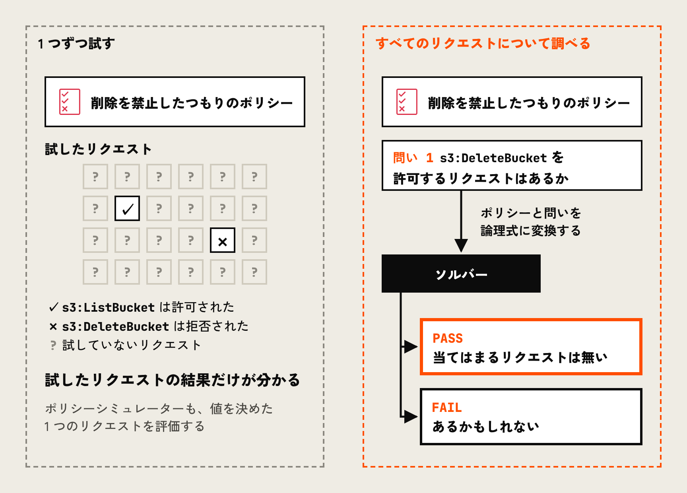
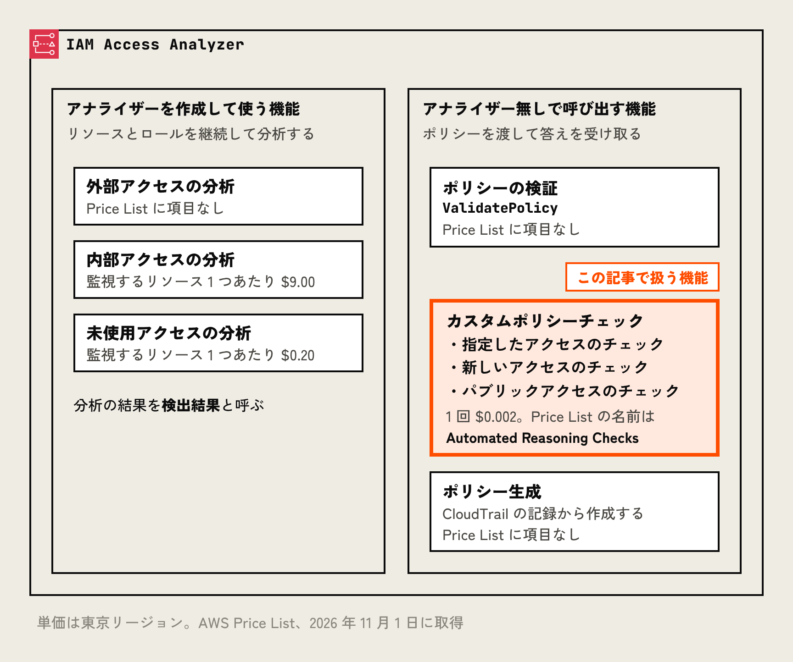
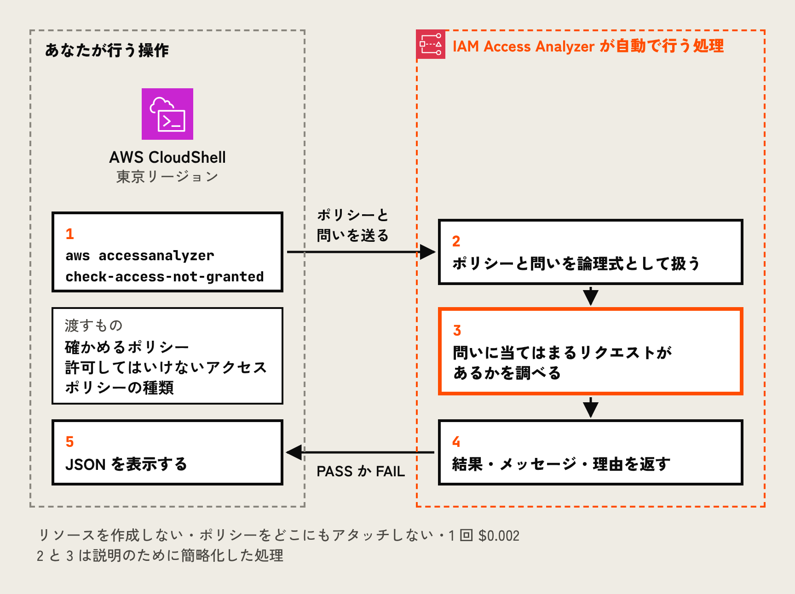
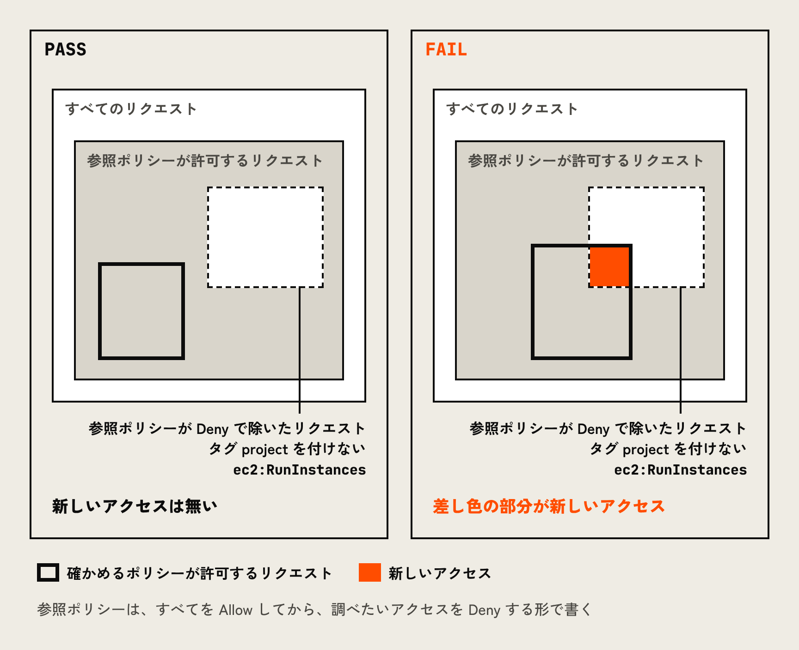
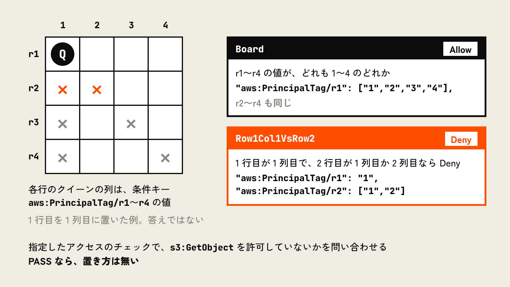
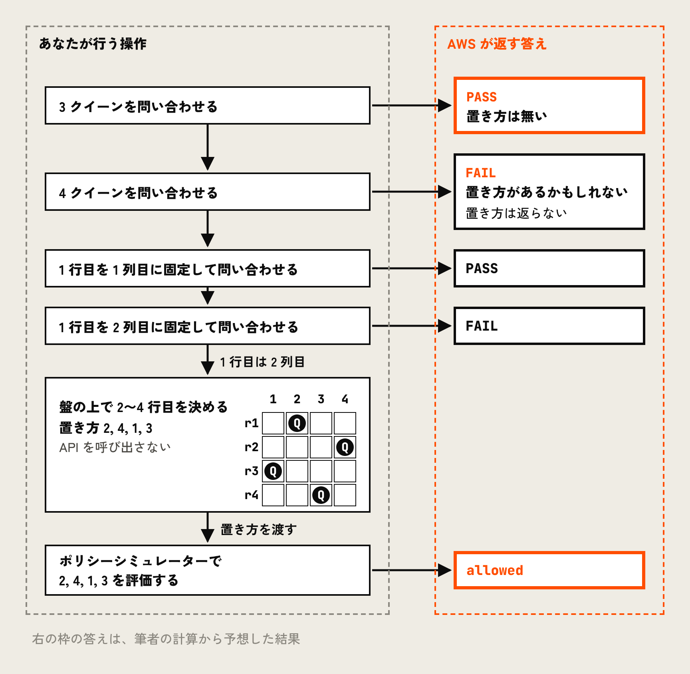
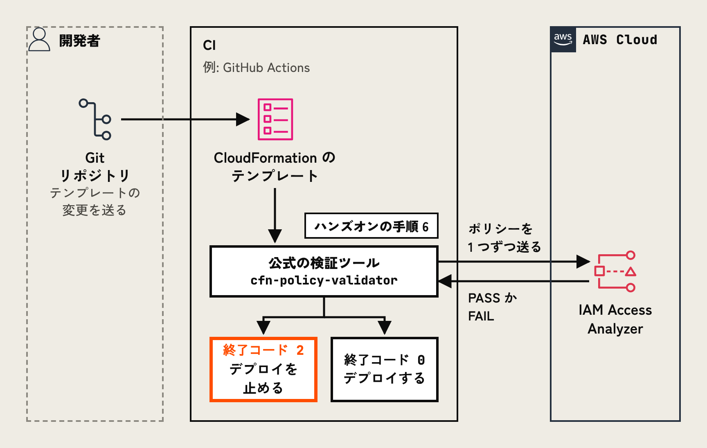
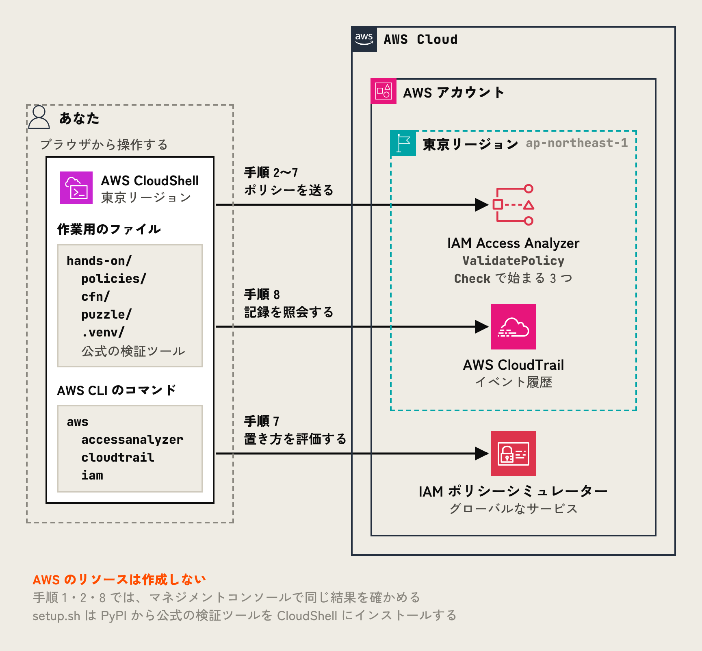

:::note info
AWS Deep Cuts の GitHub はこちらです。
https://github.com/AWS-Deep-Cuts/AWS-Deep-Cuts
:::

# AWS Deep Cutsとは？
AWS Deep Cutsは、AWS の最新のサービスやニッチな機能、または高度にアカデミックな知識を要求するサービスなど、多くの人が知らない 『隠れた名曲 = **Deep Cuts**』 を深くまで掘り下げる技術シリーズです。

このようなサービスはWeb情報も少なく、初学者は気軽にキャッチアップできないのが実情です。

そこで AWS Deep Cuts シリーズでは、**前提知識も含めた分かりやすいサービス解説** と **手順通りに進めれば誰でも再現できるハンズオン** を提供します！

# そもそも自動推論とは？
IAM ポリシーを書いたら、そのポリシーをアタッチしたロールで実際に操作してみて、意図どおりに動くかを確かめる方は多いと思います。たとえば、レポートを保存する S3 バケットの中身を誤って消されないように、そのバケットに対して `s3:*` を許可したうえで、`s3:Delete*` だけを拒否するポリシーを書き、ロールにアタッチしたとします。`s3:*` は S3 のすべての操作を、`s3:Delete*` は名前が Delete で始まるすべての操作を表します。IAM ポリシーには、このように、操作を許可する Allow と、操作を拒否する Deny を書けます。

次に、このロールで AWS CLI のコマンドを実行して確かめます。バケットのオブジェクトの一覧の取得は成功し、バケットの削除は `AccessDenied` のエラーで拒否されました。期待どおりの結果です。これで削除は防げたと考えて、ひとまず安心します。

ただし、この確かめ方で分かるのは、試した操作の結果だけです。

なぜ試した操作の結果しか分からないのかを考えるために、まず IAM がリクエストをどう判断するかを確認します。AWS に送られる 1 回の操作の依頼を、**リクエスト**と呼びます。IAM（AWS Identity and Access Management）は、3 つの要素をもとに、リクエストを許可するかどうかを決めます。1 つ目は、リクエストを送った IAM ユーザーや IAM ロールである**プリンシパル**です。2 つ目は、`s3:ListBucket` のように操作を表す**アクション**です。3 つ目は、操作の対象の**リソース**です。

IAM が判断に使うのは、この 3 つだけではありません。送信元の IP アドレスや、プリンシパルに付いたタグのような、リクエストに付随する情報も判断に使われます。ポリシーの中では、付随する情報を**条件キー**で参照します。たとえば、送信元の IP アドレスは、条件キー `aws:SourceIp` で参照します。

IP アドレスやタグの値のように、条件キーの値には無数の候補があります。そのため、アクションと条件キーの値の組み合わせも無数にあり、すべてのリクエストを試すことはできません。IAM には、条件キーの値を決めた 1 つのリクエストについて、ポリシーが許可するかどうかを評価する**ポリシーシミュレーター**もあります。API の仕様では、ポリシーシミュレーターは実際の操作を行わずに評価します。それでも、リクエストを 1 つずつ確かめる方法であることに変わりはありません。

では、試していないリクエストの中に許可されてしまうものが無いことを、すべてのリクエストを試さずに確かめる方法は無いのでしょうか。

その方法の 1 つが、ポリシーと問いを**論理式**に変換することです。論理式は、「アクションが `s3:*` に当てはまる」のような条件を、「かつ」「または」「ではない」で組み合わせた式です。ポリシーと「〜を許可するリクエストはあるか」という問いを 1 つの論理式にまとめると、問いに当てはまるリクエストがあるかどうかは、その論理式を真にする値の組があるかどうかで判断できます。

冒頭のポリシーで、具体的に考えます。次の式は、説明のために簡略化したもので、AWS の内部で使われている式ではありません。リソースと条件キーは省き、アクションだけで考えます。

```text
ポリシーが許可するリクエスト:
  アクションが s3:* に当てはまる
  かつ アクションが s3:Delete* に当てはまらない

問い 1「s3:DeleteBucket を許可するリクエストはあるか」:
  アクションが s3:* に当てはまる
  かつ アクションが s3:Delete* に当てはまらない
  かつ アクションが s3:DeleteBucket である
  → 3 つの条件を同時に満たすアクションは無い。答えは「無い」
```

問い 1 の式を満たすアクションを探すと、1 つもありません。このように、論理式を真にする値の組があるかどうかを調べるプログラムを、**ソルバー**と呼びます。確かめたい性質を論理式で表し、すべての場合について成り立つかどうかをソルバーのようなプログラムで確かめる方法を、この記事では**自動推論**と呼びます。

問い 1 の答えは、冒頭でバケットの削除を試した結果と一致します。違うのは確かめ方です。ソルバーは、リクエストを 1 つも送らずに、`s3:DeleteBucket` を許可するリクエストが 1 つも無いことを示します。

次に、冒頭では試していない操作を考えます。`s3:*` には、S3 バケットの**バケットポリシー**を書き換える `s3:PutBucketPolicy` も含まれます。バケットポリシーは、S3 バケットに設定し、そのバケットへの操作を誰に許可するかを定めるポリシーです。バケットポリシーを書き換えられると、削除は防げていても、誰がバケットにアクセスできるかを変えられてしまいます。

```text
問い 2「s3:PutBucketPolicy を許可するリクエストはあるか」:
  アクションが s3:* に当てはまる
  かつ アクションが s3:Delete* に当てはまらない
  かつ アクションが s3:PutBucketPolicy である
  → s3:PutBucketPolicy が 3 つの条件を満たす。答えは「ある」
```

問い 2 の式を満たすアクションがあるため、このポリシーはバケットポリシーの書き換えを許可していることになります。削除を禁止したつもりのポリシーに、試していない危険な操作が残っていました。なお、AWS のチェックは、このような答えを「許可しうる」と表現します。その理由は、仕組みの章の「PASS と FAIL の読み方」の節で説明します。

ここまでの 2 つの確かめ方を比べると、次の図のようになります。左の「1 つずつ試す」方法では、試したリクエストの結果だけが分かります。右の「すべてのリクエストについて調べる」方法では、ポリシーと問いを論理式に変換し、すべてのリクエストを調べる対象にします。



AWS にも、IAM ポリシーをこのように調べる機能があります。それが、次の章で紹介する IAM Access Analyzer の**カスタムポリシーチェック**です。AWS は、価格表である AWS Price List で、この機能に Automated Reasoning Checks、つまり自動推論のチェックという名前を付けています。AWS Price List は誰でも取得できる JSON のため、仕組みの章の料金の節で、自分で確かめるコマンドを紹介します。

:::note info
**IAM Access Troubleshooter の回との違い**
同じシリーズの IAM Access Troubleshooter の回では、拒否された 1 つのリクエストについて、どのポリシーが原因だったのかを調べました。この記事では反対に、ポリシーが許可しうるすべてのリクエストについて調べます。IAM Access Troubleshooter の回のハンズオンは、次のリポジトリにあります。
https://github.com/AWS-Deep-Cuts/aws-iam-toolbox
:::

# IAM Access Analyzerとは？
前の章で触れた IAM Access Analyzer は、IAM のポリシーが許可するアクセスを分析し、ポリシーの作成を助ける機能をまとめた AWS のサービスです。API の説明文によると、主な機能は次の 3 つに分かれます。1 つ目はアクセスの分析で、外部アクセス・内部アクセス・未使用アクセスの 3 種類があります。2 つ目はポリシーチェックで、基本とカスタムの 2 種類があります。3 つ目はポリシー生成です。なお、API の説明文によると、外部アクセスの分析も、論理に基づく推論（logic-based reasoning）でポリシーを分析します。

これらの機能は、次の図のように、アナライザーを作成して使う機能と、アナライザー無しで呼び出す機能に分けられます。図の左の機能は、アカウントの中のリソースやロールを継続して分析します。図の右の機能は、ポリシーの文字列を渡すと、その場で答えを返します。この記事で扱うのは、図の右のオレンジ色の枠で囲んだカスタムポリシーチェックです。



図の左の**アナライザー**は、分析の範囲を 1 つの AWS アカウントか AWS Organizations の**組織**に決めて作成する、Access Analyzer のリソースです。組織は、AWS Organizations で複数の AWS アカウントをまとめたものです。アナライザーが分析した結果を、**検出結果**と呼びます。この記事のカスタムポリシーチェックは、アナライザーを使いません。ただし、後で説明する料金と、ハンズオンの後片付けでは、アナライザーの有無が関係します。

Access Analyzer の機能は次のとおりです。

| 機能 | 何を調べるか | アナライザー |
| --- | --- | --- |
| 外部アクセスの分析 | 外部のアカウントや匿名のユーザーが、リソースにアクセスできるか | 必要 |
| 内部アクセスの分析 | 組織やアカウントの中の誰が、選んだリソースにアクセスできるか | 必要 |
| 未使用アクセスの分析 | 使われていない IAM ロール・アクセスキー・コンソールのパスワード・権限 | 必要 |
| ポリシーの検証 | ポリシーの文法とベストプラクティス | 不要 |
| カスタムポリシーチェック | ポリシーが、指定した条件に反するアクセスを許可しうるか | 不要 |
| ポリシー生成 | CloudTrail の記録から、使われたアクションのポリシーを作成する | 不要。CloudTrail を読み取るサービスロールが必要 |

表のポリシー生成で使う AWS CloudTrail は、AWS の API の呼び出しをイベントとして記録するサービスです。各機能の料金は、仕組みの章の料金の節で説明します。

この記事で扱うのは、カスタムポリシーチェックです。AWS SDK に API が追加されたのは、`CheckAccessNotGranted` と `CheckNoNewAccess` が 2023 年 11 月 27 日、`CheckNoPublicAccess` が 2024 年 6 月 11 日です。

カスタムポリシーチェックは、IAM の 2 種類のポリシーを調べます。**ID ベースポリシー**は、IAM のユーザー・グループ・ロールに設定し、そのユーザーやロールに操作を許可または拒否するポリシーです。**リソースベースポリシー**は、S3 バケットなどのリソースに設定し、そのリソースへの操作を誰に許可するかを定めるポリシーです。前の章のバケットポリシーは、S3 バケットのリソースベースポリシーです。また、ロールのリソースベースポリシーのうち、そのロールを引き受けられるプリンシパルを定めるものを、**信頼ポリシー**と呼びます。ロールを引き受けるとは、プリンシパルが、そのロールの権限を一時的に使えるようになることです。

カスタムポリシーチェックには、次の 3 つのチェックがあります。表の問いは、API の説明文をもとにした筆者の訳です。

| チェック | API | 問い | 主な入力 |
| --- | --- | --- | --- |
| 指定したアクセスのチェック | `CheckAccessNotGranted` | 確かめるポリシーは、許可してはいけないアクセスを許可していないか | 確かめるポリシーと、許可してはいけないアクセスを表すアクションとリソース |
| 新しいアクセスのチェック | `CheckNoNewAccess` | 確かめるポリシーは、参照ポリシーより広いアクセスを許可していないか | 確かめるポリシーと参照ポリシー |
| パブリックアクセスのチェック | `CheckNoPublicAccess` | リソースベースポリシーは、指定した種類のリソースを公開していないか | リソースベースポリシーと、リソースの種類 |

パブリックアクセスのチェックの「公開」は、誰でもアクセスできる状態を指します。API の仕様では、リソースの種類は、S3 バケット・KMS キー・Lambda 関数などの 26 種類から指定します。確かめるポリシーと参照ポリシーの意味は、仕組みの章で説明します。

カスタムポリシーチェックには、以下のような特徴があります。

- **アナライザーもリソースも不要**
  ポリシーの文字列を渡すだけで、答えが返ります。API の仕様では、3 つのチェックのリクエストには、アナライザーやリソースの ARN を指定する項目がありません。チェックは、リソースを作成せず、ポリシーをどこにもアタッチしません。
- **答えは PASS か FAIL**
  応答に含まれるのは、結果・メッセージ・理由の 3 つだけです。結果は PASS か FAIL のどちらかで、2 つの結果の読み方は、仕組みの章で説明します。
- **呼び出し 1 回ごとに課金される**
  東京リージョンでは 1 回 $0.002 で、1 ドル 160 円で換算すると約 0.3 円です。Price List にあるすべてのリージョンで、単価は同じです。AWS が公開している検証ツールの README も、チェックごとに料金がかかると書いています。
- **東京リージョンで使える**
  AWS SDK のエンドポイントの定義では、東京を含む標準の 34 のリージョンすべてに、Access Analyzer のエンドポイントがあります。IAM はグローバルなサービスですが、Access Analyzer はリージョンごとのサービスのため、呼び出すときはリージョンを指定します。
- **デプロイ前の検証に使える公式のツールがある**
  AWS は、CloudFormation のテンプレート用と Terraform 用の検証ツールと、GitHub Action を公開しています。使い方は、活用事例の章で紹介します。

アナライザー無しで呼び出せる機能には、**ポリシーの検証**もあります。ポリシーの検証は、ポリシーの書き方を調べる機能で、AWS の分類では基本のポリシーチェックに当たります。文法の誤りや、ベストプラクティスに反する書き方を、JSON の行と列の位置付きで指摘します。ポリシーの検証が返す 1 件ずつの結果を、この記事では**指摘**と呼び、アナライザーの検出結果と区別します。

一方で、ポリシーの検証は、ポリシーが何を許可するかには答えません。たとえば、「このポリシーで、レポートのバケットのバケットポリシーを書き換えられるか」という問いには答えません。この問いに答えるのが、カスタムポリシーチェックです。

# 仕組み
ここまでで、カスタムポリシーチェックに 3 つのチェックがあることを紹介しました。この章では、1 回のチェックで何が起きるのかを、実際のコマンドと JSON で説明します。そのうえで、新しいアクセスのチェックの考え方、結果の読み方、パズルを使った確かめ方、料金を順に説明します。

| 節 | 説明すること |
| --- | --- |
| 1 回のチェックで起きること | コマンドの入力、AWS の中の処理、応答の JSON |
| 新しいアクセスのチェックは許可の範囲を比べる | 参照ポリシーと、PASS になる条件 |
| PASS と FAIL の読み方 | 2 つの結果の意味の違いと、チェックが知らないこと |
| Access Analyzer で N クイーン問題を解く | PASS と FAIL の違いと、ポリシーシミュレーターとの組み合わせ方を、パズルで確かめる方法 |
| 料金 | 料金の要素と、CI で使うときの見積もり方 |

この章の図の一部は、ハンズオンと共通です。図の「あなた」は、ポリシーを確かめる人を指します。

## 1 回のチェックで起きること
指定したアクセスのチェックを例に、1 回のチェックで起きることを説明します。次の図は、その流れを示しています。図の番号は、この節の説明の番号と対応しています。



図の左の操作は、ブラウザから AWS CLI のコマンドを実行できる AWS CloudShell で行います。次のコマンドは、「そもそも自動推論とは？」の章の問い 2「`s3:PutBucketPolicy` を許可するリクエストはあるか」を、指定したアクセスのチェックで調べます。ハンズオンの手順 3-2 でも、同じチェックを実行します。

```bash
aws accessanalyzer check-access-not-granted \
  --policy-document file://s3-no-delete.json \
  --access '[{"actions":["s3:PutBucketPolicy"]}]' \
  --policy-type IDENTITY_POLICY
```

`s3-no-delete.json` は、「そもそも自動推論とは？」の章の、削除を禁止したつもりのポリシーです。中身は次のとおりです。バケットの名前は、AWS がドキュメントの例に使う説明用の名前です。

```json
{
  "Version": "2012-10-17",
  "Statement": [
    {
      "Sid": "AllowReportBucket",
      "Effect": "Allow",
      "Action": "s3:*",
      "Resource": [
        "arn:aws:s3:::amzn-s3-demo-bucket",
        "arn:aws:s3:::amzn-s3-demo-bucket/*"
      ]
    },
    {
      "Sid": "DenyAnyDelete",
      "Effect": "Deny",
      "Action": "s3:Delete*",
      "Resource": "*"
    }
  ]
}
```

ポリシーは、`Statement` の中に 1 つ以上の**ステートメント**を並べたものです。ステートメントは、ポリシーの中の 1 つの規則です。`Effect` には許可する Allow か拒否する Deny を書き、この値をステートメントの**効果**と呼びます。`Action` にはアクションを書き、`Resource` には、AWS のリソースを一意に識別する名前である ARN（Amazon Resource Name）を書きます。`Sid` は、ステートメントを区別するために付ける ID です。

このポリシーには、効果が Allow のステートメント `AllowReportBucket` と、効果が Deny のステートメント `DenyAnyDelete` の 2 つがあります。同じシリーズの IAM Access Troubleshooter の回で説明したとおり、リクエストに一致する Deny のステートメントが 1 つでもあれば、IAM はリクエストを拒否します。そのため、`s3:*` を許可していても、名前が Delete で始まる操作は拒否されます。

コマンドの 3 つのパラメータの意味は、次のとおりです。

| パラメータ | この記事での呼び名 | 内容 |
| --- | --- | --- |
| `--policy-document` | 確かめるポリシー | 調べる対象のポリシーの JSON を、文字列で渡す |
| `--access` | 許可してはいけないアクセス | アクションとリソースの組で、1 つだけ指定できる。その中に、アクションを 100 個まで、リソースの ARN を 100 個まで書ける。ARN のワイルドカードは、リソース ID の部分だけで使える |
| `--policy-type` | ポリシーの種類 | ID ベースポリシーを表す `IDENTITY_POLICY` か、リソースベースポリシーを表す `RESOURCE_POLICY` のどちらか |

API の説明文によると、許可してはいけないアクセスにアクションだけを指定すると、Access Analyzer は、どれか 1 つのアクションを、どこかのリソースに対して許可しうるかを調べます。アクションとリソースの両方を指定すると、どれかのアクションを、指定したリソースのどれかに対して許可しうるかを調べます。上のコマンドはアクションだけを指定しているため、`s3:PutBucketPolicy` を、どこかのリソースに対して許可しうるかを調べます。

コマンドを実行すると、図の番号の順に次のことが起きます。

1. AWS CLI が、確かめるポリシーと問いを、Access Analyzer の API に送ります。API の仕様では、この呼び出しは `/policy/check-access-not-granted` というパスへの POST リクエストです。
2. Access Analyzer が、ポリシーと問いを論理式として扱います。
3. Access Analyzer が、問いに当てはまるリクエストがあるかを調べます。
4. Access Analyzer が、結果・メッセージ・理由を返します。
5. AWS CLI が、受け取った JSON を表示します。

このうち 2 と 3 は、説明のために簡略化した処理です。API の説明文には、3 つのチェックの内部の処理は書かれていません。一方で、AWS の公式サンプルの README によると、新しいアクセスのチェックは Zelkova という仕組みの上に作られています。同じ README は、Zelkova が IAM ポリシーを同じ意味の論理式に翻訳し（translates IAM policies into equivalent logical statements）、汎用と専用の論理ソルバーの一式で問題を解くと説明しています。README は、このソルバーの種類として SMT（Satisfiability Modulo Theories）を挙げています。ただし、Zelkova と SMT という語は、API の説明文には出てきません。また、筆者は、指定したアクセスのチェックとパブリックアクセスのチェックについて、同じ説明を見つけられていません。

応答は、次の形の JSON です。この例は、AWS CLI の公式のコマンド例と API の仕様をもとにした、出力の形の例です。`message` と `description` の文面は「...」で省略しています。

```json
{
    "result": "FAIL",
    "message": "...",
    "reasons": [
        {
            "description": "...",
            "statementIndex": 0,
            "statementId": "AllowReportBucket"
        }
    ]
}
```

応答の項目は、次のとおりです。

| 応答の項目 | この記事での呼び名 | 内容 |
| --- | --- | --- |
| `result` | 結果 | `PASS` か `FAIL` |
| `message` | メッセージ | 結果を説明する英語の文 |
| `reasons[].description` | 理由 | 結果に関わったステートメントについての説明 |
| `reasons[].statementIndex` | 理由 | 結果に関わったステートメントの番号。`Statement` の中の位置を、0 から数えた値 |
| `reasons[].statementId` | 理由 | 結果に関わったステートメントの Sid |

API の仕様では、カスタムポリシーチェックには、メッセージの言語を選ぶ `locale` のパラメータがありません。そのため、メッセージは英語だけで返ると考えられます。上の例の `statementIndex` の `0` は、1 つ目のステートメント `AllowReportBucket` を指しています。

チェックが終わっても、AWS にリソースは作成されません。Access Analyzer は、受け取ったポリシーをどこにもアタッチしません。課金されるのは、チェックを呼び出した回数だけです。

## 新しいアクセスのチェックは許可の範囲を比べる
ポリシーの変更をレビューするとき、変更前と変更後の文字の差分を読んでも、許可が広がったかどうかはすぐには分かりません。ステートメントを分けたりアクションを並べ替えたりすると、許可する範囲が変わらなくても、差分は大きくなります。反対に、ワイルドカードの位置が 1 か所変わるだけで、許可が大きく広がることもあります。

新しいアクセスのチェックには、確かめるポリシーと、比べる基準にするポリシーの 2 つを渡します。基準にするポリシーを、**参照ポリシー**と呼びます。AWS の公式サンプルの README によると、確かめるポリシーが許可するリクエストが、参照ポリシーが許可するリクエストの部分集合であれば、結果は PASS になります。つまり、新しいアクセスのチェックは、2 つのポリシーの文字ではなく、許可するリクエストの範囲を比べます。

次の図は、このことを示したものです。外の長方形はすべてのリクエストを、灰色の部分は参照ポリシーが許可するリクエストを表します。白い点線の部分は、参照ポリシーが Deny で除いたリクエストです。黒の太線で囲んだ部分が、確かめるポリシーが許可するリクエストです。左のように、黒の太線の部分が灰色の部分に収まっていれば PASS です。右のように、白い点線の部分にはみ出していれば FAIL で、オレンジ色の部分が新しいアクセスです。



公式サンプルは、参照ポリシーを「すべてを Allow してから、調べたいアクセスを Deny する」形で書くよう勧めています。次の参照ポリシーは、公式サンプルの参照ポリシーのタグのキーを `project` に替えたもので、ハンズオンの手順 4-2 で使います。表している規則は、「EC2 のインスタンスを起動するときは、必ずタグ `project` を付ける」です。

```json
{
  "Version": "2012-10-17",
  "Statement": [
    {
      "Sid": "AllowEverything",
      "Effect": "Allow",
      "Action": "*",
      "Resource": "*"
    },
    {
      "Sid": "DenyRunInstancesWithoutProjectTag",
      "Effect": "Deny",
      "Action": "ec2:RunInstances",
      "Resource": "*",
      "Condition": {
        "Null": {
          "aws:RequestTag/project": "true"
        }
      }
    }
  ]
}
```

条件キー `aws:RequestTag/project` は、リクエストで付けようとしているタグ `project` の値を表します。条件演算子 `Null` の値が `true` のときは、そのキーがリクエストに無いことを表します。そのため、2 つ目のステートメントは、タグ `project` を付けずに EC2 のインスタンスを起動するリクエストを拒否します。図の白い点線の部分が、このステートメントで除いたリクエストに当たります。

新しいアクセスのチェックの使い方は、主に次の 2 つです。

- **変更前と変更後を比べる**
  変更前のポリシーを参照ポリシーとして渡し、変更後のポリシーを確かめるポリシーとして渡します。AWS CLI の公式のコマンド例では、`s3:GetObject` と `s3:ListBucket` を許可するポリシーに `s3:GetObjectAcl` を足した変更で、結果が FAIL になり、理由の説明が `New access in the statement with index: 0.` になっています。
- **社内の規則と比べる**
  上の例のように、社内の規則を参照ポリシーで表し、確かめるポリシーが規則より広い許可を持たないかを調べます。

ただし、参照ポリシーの書き方によっては、実際には許可しないのに FAIL になることがあります。これを**偽陽性**と呼びます。公式サンプルによると、チェックは、アクションと条件・リソースの関係をすべては知りません。公式サンプルは、その例として、すべてを Allow したうえで、`s3:*` を特定のバケットに対してだけ Deny する参照ポリシーを挙げています。S3 には、`s3:ListAllMyBuckets` のように、特定のリソースを指定できないアクションがあります。チェックは、このようにリソースを指定できないアクションがあることを知りません。そのため、この参照ポリシーと比べると、チェックは、S3 のアクションを許可するポリシーには必ずリソースの指定が必要だと見なします。ところが、リソースを指定できないアクションでは、その指定ができません。その結果、偽陽性が生じると公式サンプルは説明しています。

## PASS と FAIL の読み方
前の節で、新しいアクセスのチェックの結果が PASS になる条件を説明しました。この節では、PASS と FAIL がそれぞれ何を意味しているのかを、3 つのチェックに共通する形で説明します。

API の説明文は、3 つのチェックのどれについても、PASS を「許可しない（doesn't allow）」と言い切り、FAIL を「許可しうる（might allow）」と書いています。たとえば、指定したアクセスのチェックでは、PASS なら、確かめるポリシーは許可してはいけないアクセスのどれも許可しません。FAIL なら、確かめるポリシーは、許可してはいけないアクセスの一部またはすべてを許可しうる、という意味です。2 つの結果は、意味の強さが違います。

FAIL のとき、どのようなリクエストなら許可されるのかを示す具体例は、応答に含まれません。返るのは、結果・メッセージ・理由だけです。外部アクセスの分析の検出結果が、誰が・どのアクションを・どの条件で実行できるかを返すのとは対照的です。

FAIL を受け取ったら、理由のステートメントの番号を手がかりに、ポリシーを読み直します。必要であれば、疑わしいリクエストの条件キーの値を決めて、ポリシーシミュレーターで評価します。ただし、API の説明文によると、ポリシーシミュレーターの結果も、実際の環境での結果と異なることがあります。

また、チェックは、ポリシーの外のことをすべて知っているわけではありません。

- 前の節で説明したとおり、公式サンプルによると、チェックはアクションと条件・リソースの関係をすべては知りません。
- 公式サンプルによると、チェックは AWS Organizations の組織を知りません。たとえば、あるアカウントが自分の組織に属しているかどうかを、チェックは判断できません。組織の外からのアクセスを調べるときは、アクセスプレビューを使うよう、公式サンプルは勧めています。アクセスプレビューは、権限を変える前に、外部アクセスの検出結果を予告する Access Analyzer の機能で、アカウントを範囲とする外部アクセスのアナライザーが必要です。
- API の仕様では、チェックに渡せるポリシーの種類は、ID ベースポリシーとリソースベースポリシーの 2 つだけです。組織のアカウントで行える操作の上限を定める SCP（サービスコントロールポリシー）と RCP（リソースコントロールポリシー）は、チェックに渡せません。

最後に、ポリシーシミュレーターとカスタムポリシーチェックを比べると、次のようになります。この比較は、2 つの API の入力の項目から筆者が整理したもので、AWS がこの形で説明しているものではありません。

| | ポリシーシミュレーター | カスタムポリシーチェック |
| --- | --- | --- |
| 入力 | ポリシーと、条件キーの値を決めた 1 つのリクエスト | ポリシーと問い。条件キーの値を渡す項目は無い |
| 答え | `allowed`・`explicitDeny`・`implicitDeny` のいずれかの判定と、決め手になったステートメント | PASS か FAIL の結果と、理由 |
| 分かること | そのリクエストが許可されるか | 問いに当てはまるリクエストが 1 つも無いか |

ポリシーシミュレーターは 1 つのリクエストについて答え、カスタムポリシーチェックは問いに当てはまるすべてのリクエストについて答えます。2 つを組み合わせると、カスタムポリシーチェックで問題のありそうなポリシーを見つけ、ポリシーシミュレーターで具体的なリクエストを確かめる、という使い方ができます。次の節では、この組み合わせを、パズルで試します。

## Access Analyzer で N クイーン問題を解く

この節では、PASS と FAIL の意味の違いと、カスタムポリシーチェックとポリシーシミュレーターの組み合わせ方を、答えが分かっているパズルで確かめます。題材は N クイーン問題です。ここまでで、ポリシーと問いを論理式に置き換えて考える方法を説明しました。チェックがこの考え方どおりに答えるのであれば、論理式で表せるパズルをポリシーに書くと、チェックで解けるはずです。

**N クイーン問題**は、N×N のチェス盤に N 個のクイーンを、互いに取り合わないように置く問題です。クイーンは、縦・横・斜めにどこまでも進めるチェスの駒です。ここでは、盤の 1 行に 1 つずつクイーンを置くことにし、各行のクイーンを何列目に置くかを決めます。各行のクイーンの列の組を、**置き方**と呼びます。

4 クイーン問題をポリシーに書くと、次の図のようになります。図の盤は答えではなく、1 行目のクイーンを 1 列目に置いた例です。



ポリシーには、次のように書きます。

- 1〜4 行目のクイーンの列を、プリンシパルのタグ `r1`〜`r4` の値 `"1"`〜`"4"` で表します。ポリシーの中では、条件キー `aws:PrincipalTag/r1` などで参照します。
- 効果が Allow のステートメント `Board` を 1 つ書き、4 つのタグの値がどれも `"1"`〜`"4"` のどれかであることを、`StringEquals` の条件で求めます。
- 互いに取り合う置き方を、効果が Deny のステートメントで拒否します。たとえば、ステートメント `Row1Col1VsRow2` は、1 行目のクイーンが 1 列目にあるとき、2 行目のクイーンが 1 列目か 2 列目にある置き方を拒否します。
- このポリシーを確かめるポリシーとして、指定したアクセスのチェックに渡し、許可してはいけないアクセスに `s3:GetObject` を指定します。

IAM ユーザーガイドの条件の評価の規則では、1 つの条件の中の異なる条件キーは「かつ」で組み合わされ、1 つの条件キーに並べた複数の値は「または」で組み合わされるとされています。この規則どおりにポリシーが論理式に変換されるなら、`s3:GetObject` を許可するリクエストがあることは、取り合わない置き方があることと同じ意味になります。そのため、結果が PASS なら、置き方は 1 つもありません。

<!-- 要確認: IAM ユーザーガイドの条件の評価の規則の記述を確かめる。シミュレーターの判定（2,4,1,3 が allowed、2,4,1,4 が explicitDeny）は 2026-11 に実機で確かめた。ユーザーガイドの記述は未確認 -->

筆者が手元のプログラムですべての置き方を調べたところ、3 クイーン問題の置き方は 1 つも無く、4 クイーン問題の置き方は 2 つありました。1 行目から順に列を並べると、2・4・1・3 と 3・1・4・2 です。そのため、チェックの結果は、3 クイーン問題では PASS、4 クイーン問題では FAIL になると予想されます。

4 クイーン問題の FAIL は「置き方があるかもしれない」という意味で、置き方そのものは返りません。そこで、1 行目のクイーンの列を固定したポリシーを作成して、チェックし直します。筆者の計算では、1 行目を 1 列目に固定すると置き方は無いため PASS、2 列目に固定すると置き方が 1 つ残るため FAIL になります。

1 行目を 2 列目に決めると、残りの行は、Deny のステートメントから盤の上で決められます。2 行目に置ける列は 4 列目だけになり、続けて 3 行目は 1 列目、4 行目は 3 列目に決まります。こうして得た置き方 2・4・1・3 を、4 つのタグの値としてポリシーシミュレーターに渡せば、1 つの具体的なリクエストとして確かめられます。筆者の計算では、判定は `allowed` になります。この流れをまとめると、次の図のとおりです。



この節の PASS・FAIL と判定は、筆者の計算から予想した結果です。2026 年 11 月に東京リージョンで実行したところ、チェックの結果とポリシーシミュレーターの判定は、どれも予想のとおりになりました。置き方 2・4・1・4 の判定は `explicitDeny` でした。同じことは、ハンズオンの手順 7 で確かめられます。

この例から、PASS と FAIL の意味の違いが具体的に分かります。PASS は「置き方は無い」という答えで、それ以上調べる必要はありません。FAIL は「あるかもしれない」という答えで、置き方は返らないため、条件を絞ってチェックし直し、最後はポリシーシミュレーターで具体的なリクエストとして確かめます。

1 行目だけでなく、すべての行の列をチェックで 1 つずつ決める方法でも、4 クイーン問題の呼び出しは多くても 13 回で、東京リージョンでは最大 $0.026 です。一方で、9×9 の数独のような大きな問題は、同じ方法でポリシーに書くと 100 KB を超えるため、この方法には向きません。

## 料金
最後に、ここまでのチェックにかかる料金を説明します。Access Analyzer の料金の要素は、次のとおりです。単価は、筆者が 2026 年 11 月 1 日に AWS Price List から取得した、東京リージョンの値です。

| 料金の要素 | かかるとき | 東京リージョンの単価 |
| --- | --- | --- |
| カスタムポリシーチェックの料金 | 3 つのチェックを呼び出すたび | 1 回 $0.002 |
| 未使用アクセスの分析の料金 | 未使用アクセスのアナライザーが IAM ロールとユーザーを分析するとき | 監視するリソース 1 つあたり $0.20 |
| 内部アクセスの分析の料金 | 内部アクセスのアナライザーがリソースを分析するとき | 監視するリソース 1 つあたり $9.00 |

外部アクセスの分析・ポリシーの検証・ポリシー生成は、Price List に項目がありません。Price List に項目が無いことは、無料であることの証明ではありません。これらの料金は、料金ページで確かめてください。

<!-- 要確認: 料金ページで、外部アクセスの分析・ポリシーの検証・アクセスプレビュー・ポリシー生成の料金の記述を確かめる。内部アクセスの $9.00 が月あたりかどうかも確かめる -->

カスタムポリシーチェックの単価は、2023 年 11 月の最初の版から変わっていません。また、Price List の単価には段階が 1 つだけあり、無料の段階はありません。そのため、Price List に従えば、最初の 1 回から $0.002 がかかります。エラーで終わった呼び出しが課金されるかどうかは、筆者は確かめられていません。見積もりでは、呼び出した回数をそのまま使います。

<!-- 要確認: 料金ページと、ハンズオンの翌日以降の Cost Explorer で、無料利用枠の有無と、エラーで終わった呼び出しが課金されるかを確かめる -->

CI（Continuous Integration）は、コードの変更を自動でビルド・テストする仕組みです。チェックを CI に組み込むと、呼び出しの回数は、ポリシーの数と実行の回数に比例して増えます。CloudFormation 用の公式の検証ツールは、テンプレートの中のポリシー 1 つごとに API を 1 回呼び出します。ただし、同じ本文のポリシーは 1 回だけ送り、パブリックアクセスのチェックでは ID ベースポリシーを送りません。また、許可してはいけないアクションが 100 個を超えると、100 個ずつに分けて呼び出します。そのため、費用は次の式で多めに見積もります。

```text
1 日の費用の見積もり = ポリシーの数 × チェックの種類の数 × アクションを 100 個ずつに分けた組の数 × 1 日の実行の回数 × $0.002
```

説明用の例として、ポリシーが 10 個あるテンプレートに 3 種類のチェックを 1 日 20 回実行すると、アクションが 100 個以下なら、10 × 3 × 1 × 20 × $0.002 = 1 日 $1.20 です。ただし、公式の検証ツールは、スロットリングなどのエラーのときに自動で再試行するため、呼び出しがこれより増えることがあります。

「そもそも自動推論とは？」の章で触れたとおり、AWS Price List は、認証の要らない公開の JSON です。次のコマンドで、Access Analyzer の東京リージョンの価格を取得し、項目の名前だけを表示できます。AWS の API を呼び出さないため、Access Analyzer の料金はかかりません。

```bash
curl -s https://pricing.us-east-1.amazonaws.com/offers/v1.0/aws/AWSIAMAccessAnalyzer/current/ap-northeast-1/index.json \
  | grep -o -E '"(checkType|usagetype)" ?: ?"[^"]*"' | sort -u
```

2026 年 11 月 1 日に実行したときの出力は、次の 4 行でした。

```text
"checkType" : "Automated Reasoning Checks"
"usagetype" : "APN1-AccessFinding-Monitored-AWS-Resources"
"usagetype" : "APN1-AccessFinding-Monitored-IAM-Resources"
"usagetype" : "APN1-CustomCheck-API-Requests"
```

最後の行の `APN1-CustomCheck-API-Requests` が、東京リージョンのカスタムポリシーチェックの使用量を表す名前です。1 行目の Automated Reasoning Checks は、この項目に付けられたチェックの種類の名前です。

なお、未使用アクセスと内部アクセスのアナライザーは、分析する IAM ロールとユーザーの数や、リソースの数に応じて課金されます。API の説明文によると、未使用アクセスは、月あたりに分析した IAM ロールとユーザーの数で課金されます。課金の期間と数え方は、料金ページで確かめてください。この記事のハンズオンでは、アナライザーを作成しません。

# IAM Access Analyzerの主な活用事例
ここまでで、カスタムポリシーチェックが、ポリシーを渡すだけで、問いに当てはまるリクエストの有無を答えることを説明しました。この特徴は、ポリシーをデプロイする前の確認に向いています。次の使い方は、いずれも、AWS の公式のツールとサンプルをもとに、筆者が整理したものです。

- **デプロイの前に CI で止める**
  CloudFormation 用の公式の検証ツール `cfn-policy-validator` は、CloudFormation のテンプレートからポリシーを取り出してチェックし、止めるべき指摘があると終了コード 2 で終わります。終了コードは、コマンドが終わるときに返す数値で、CI は 0 を成功、0 以外を失敗として扱います。そのため、CI は、問題のあるポリシーを含むテンプレートのデプロイを止められます。同じ使い方ができる GitHub Action もあります。
- **ポリシーの変更をレビューする**
  変更前のポリシーを参照ポリシーにして、新しいアクセスのチェックで変更後のポリシーと比べます。文字の差分が大きくても、許可が広がっていなければ PASS になります。
- **社内の規則を参照ポリシーで表す**
  AWS の公式サンプルには、機密のリソースへのアクセス、権限の昇格に使われうるアクション、タグの条件の有無を調べる参照ポリシーの例があります。
- **リソースを公開していないことを確かめる**
  パブリックアクセスのチェックは、26 種類のリソースの種類に対応しています。公式の検証ツールの README によると、アナライザーを使うアクセスプレビューとは異なり、パブリックアクセスのチェックは、アカウントの状態や外部アクセスのアナライザーを前提にしません。
- **AI のコーディング支援ツールから使う**
  CloudFormation 用の公式の検証ツールのリポジトリには、Agent Skill が同梱されています。Agent Skill は、ツールやサービスの使い方をまとめ、AI エージェントが読み込んで使えるようにした文書です。AI エージェントは、人の依頼を達成するために、コマンドの実行のような操作まで自動で行う AI です。リポジトリの README によると、この Agent Skill は AWS を直接呼び出さず、検証ツールのコマンドを実行します。

1 つ目の CI の流れは、次の図のとおりです。開発者がテンプレートの変更を Git のリポジトリに送ると、CI が公式の検証ツールを実行します。検証ツールは、テンプレートのポリシーを 1 つずつ Access Analyzer に送り、PASS か FAIL を受け取ります。止めるべき指摘があれば、検証ツールは終了コード 2 で終わり、CI はデプロイを止めます。



図で「ハンズオンの手順 6」と書いた部分は、ハンズオンで CloudShell から実際に実行します。

# IAM Access Analyzerを使う際のベストプラクティス
最後に、ここまでに説明した仕組みと制約を踏まえて、カスタムポリシーチェックを使うときの注意点をまとめます。AWS の API の説明文・公式サンプル・公式のツールの記述に基づく項目には、その出典を書いています。それ以外の項目は、筆者の考えです。

- **FAIL は許可しうるという意味で扱う**
  API の説明文は、PASS を「許可しない」と言い切り、FAIL を「許可しうる」と書いています。2 つは意味の強さが違うため、同じように扱いません。FAIL を受け取ったら、理由を手がかりにポリシーを人が読み、必要ならポリシーシミュレーターで具体的なリクエストを評価します。
- **参照ポリシーは公式サンプルから始める**
  参照ポリシーの書き方によっては、偽陽性が生じます。AWS の公式サンプルの参照ポリシーと、偽陽性の例の説明を読んでから、自分の規則に合わせて書き換えます。
- **新しいチェックはまず記録だけで導入する**
  GitHub Action の README は、`treat-findings-as-non-blocking` を指定すると、指摘があっても終了コード 0 で終わると説明しています。同じ README は、この設定を、新しいチェックを強制する前に記録だけで動かすために使えると書いています。偽陽性の多さを確かめてから、デプロイを止める設定に切り替えます。
- **費用をポリシーの数と実行の回数で見積もる**
  公式の検証ツールは、ポリシー 1 つごとにチェックを呼び出し、呼び出しごとに課金されます。料金の節の式で見積もってから CI に組み込みます。
- **ポリシーの検証と組み合わせる**
  ポリシーの書き方の誤りはポリシーの検証で、許可の範囲はカスタムポリシーチェックで調べます。2 つは調べることが異なるため、片方だけでは足りません。
- **IAM ポリシーでは access-analyzer と書く**
  チェックを実行する権限を IAM ポリシーで許可するときは、アクションの名前の先頭を `access-analyzer:` にします。API の説明文と、公式の検証ツールの必要な権限の一覧が、この書き方を使っています。AWS CLI のコマンドの名前は `aws accessanalyzer` で、ハイフンがありません。AWS が公開している Agent Skill の権限の一覧には、`accessanalyzer:ListAnalyzers` のように書かれた箇所があり、API の説明文と食い違っています。
- **公式の検証ツールの validate はアナライザーを作成することがある**
  CloudFormation 用の公式の検証ツールの `validate` コマンドは、アカウントを範囲とする外部アクセスのアナライザーで、状態が ACTIVE のものが無いと、`AnalyzerCreatedByCfnIAMPolicyValidator` という名前でアナライザーを作成します。カスタムポリシーチェックを実行する `check-` で始まる 3 つのコマンドは、アナライザーを作成しません。試した後は、アナライザーの一覧を確かめます。

# ハンズオンはこちら！
ここまでの仕組みは、ハンズオンで実際に確かめられます。ハンズオンでは、東京リージョンの CloudShell から、ポリシーの検証と 3 つのチェックを 1 コマンドずつ実行し、「そもそも自動推論とは？」の章のポリシーが `s3:PutBucketPolicy` を許可しうることを確かめます。続けて、CloudFormation 用の公式の検証ツールで、CI と同じ形のチェックも試します。最後のおまけでは、4 クイーン問題を指定したアクセスのチェックで解きます。ハンズオンでは **AWS のリソースを 1 つも作成せず**、費用は最大で $0.20、1 ドル 160 円で換算して約 32 円です。

ハンズオンの構成は、次の図のとおりです。図の手順の番号は、ハンズオンの README の手順の番号です。



https://github.com/AWS-Deep-Cuts/aws-iam-access-analyzer

# まとめ
冒頭の、削除を禁止したつもりのポリシーは、削除を試した結果だけで判断すると、期待どおりに動いていました。しかし、カスタムポリシーチェックを使えば、「`s3:PutBucketPolicy` を許可するリクエストはあるか」のように、試していない操作についても、リクエストを送らずに問えます。試したリクエストの結果だけでなく、問いに当てはまるすべてのリクエストについて答えることが、AWS が Automated Reasoning Checks と名付けたカスタムポリシーチェックの特徴です。

この記事に出てきた 3 つの機能を整理すると、次のようになります。

| | ポリシーの検証 | ポリシーシミュレーター | カスタムポリシーチェック |
| --- | --- | --- | --- |
| 何に答えるか | ポリシーの書き方に、誤りや危険な書き方が無いか | 条件キーの値を決めた 1 つのリクエストが許可されるか | 問いに当てはまるリクエストが 1 つも無いか |
| 入力 | ポリシー | ポリシーと、条件キーの値を決めた 1 つのリクエスト | ポリシーと問い。問いは、許可してはいけないアクセス・参照ポリシー・リソースの種類のどれか |
| 答え | 行と列の位置付きの指摘の一覧 | `allowed`・`explicitDeny`・`implicitDeny` のいずれかの判定と、決め手になったステートメント | PASS か FAIL の結果と、理由 |
| アナライザー | 不要 | 不要。IAM の機能 | 不要 |
| 東京リージョンの料金 | Price List に項目なし | Price List に IAM の項目なし | 1 回 $0.002 |

表の「項目なし」は、無料であることの証明ではありません。料金は、料金ページで確かめてください。

ポリシーを書いたら、試すだけでなく、AWS の自動推論にも聞いてみてください！

---

参考文献
1. [IAM Access Analyzer のカスタムポリシーチェック（IAM Access Analyzer custom policy checks）](https://docs.aws.amazon.com/IAM/latest/UserGuide/access-analyzer-custom-policy-checks.html)
1. [IAM Access Analyzer の API でアクセスをプレビューする（Previewing access with IAM Access Analyzer APIs）](https://docs.aws.amazon.com/IAM/latest/UserGuide/access-analyzer-preview-access-apis.html)
1. [IAM Access Analyzer のポリシーの検証（IAM Access Analyzer policy validation）](https://docs.aws.amazon.com/IAM/latest/UserGuide/access-analyzer-policy-validation.html)
1. [CheckAccessNotGranted の API リファレンス（IAM Access Analyzer API Reference: CheckAccessNotGranted）](https://docs.aws.amazon.com/access-analyzer/latest/APIReference/API_CheckAccessNotGranted.html)
1. [CheckNoNewAccess の API リファレンス（IAM Access Analyzer API Reference: CheckNoNewAccess）](https://docs.aws.amazon.com/access-analyzer/latest/APIReference/API_CheckNoNewAccess.html)
1. [CheckNoPublicAccess の API リファレンス（IAM Access Analyzer API Reference: CheckNoPublicAccess）](https://docs.aws.amazon.com/access-analyzer/latest/APIReference/API_CheckNoPublicAccess.html)
1. [IAM Access Analyzer の料金（IAM Access Analyzer pricing）](https://aws.amazon.com/iam/access-analyzer/pricing/)
1. [AWS Price List の IAM Access Analyzer の東京リージョンの価格（AWS Price List: AWSIAMAccessAnalyzer, ap-northeast-1）](https://pricing.us-east-1.amazonaws.com/offers/v1.0/aws/AWSIAMAccessAnalyzer/current/ap-northeast-1/index.json)
1. [IAM Access Analyzer の CheckNoNewAccess の参照ポリシーの例（AWS IAM Access Analyzer CheckNoNewAccess Sample Reference Policies）](https://github.com/aws-samples/iam-access-analyzer-custom-policy-check-samples)
1. [CloudFormation 用の IAM ポリシーの検証ツール（IAM Policy Validator for AWS CloudFormation）](https://github.com/awslabs/aws-cloudformation-iam-policy-validator)
1. [CloudFormation のテンプレートの IAM ポリシーを検証する GitHub Action（Policy Validator for AWS IAM Policies in CloudFormation Templates）](https://github.com/aws-actions/cloudformation-aws-iam-policy-validator)
1. [AWS CLI の accessanalyzer のコマンド例（aws-cli: awscli/examples/accessanalyzer）](https://github.com/aws/aws-cli/tree/v2/awscli/examples/accessanalyzer)
1. [AWS CLI v2 の変更履歴（AWS CLI v2 CHANGELOG）](https://github.com/aws/aws-cli/blob/v2/CHANGELOG.rst)
1. [充足可能性モジュロ理論（Satisfiability Modulo Theories）](https://people.eecs.berkeley.edu/~sseshia/pubdir/SMT-BookChapter.pdf)
